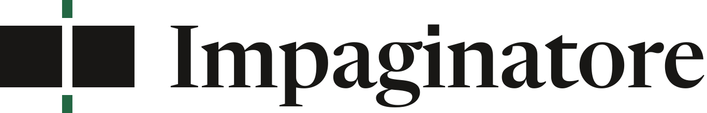
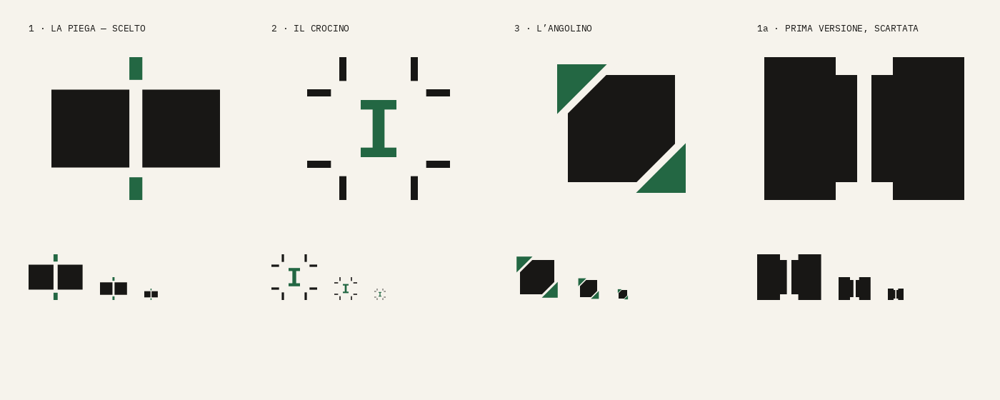
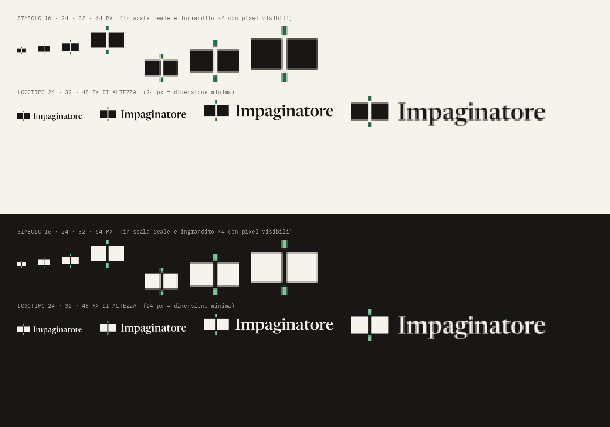
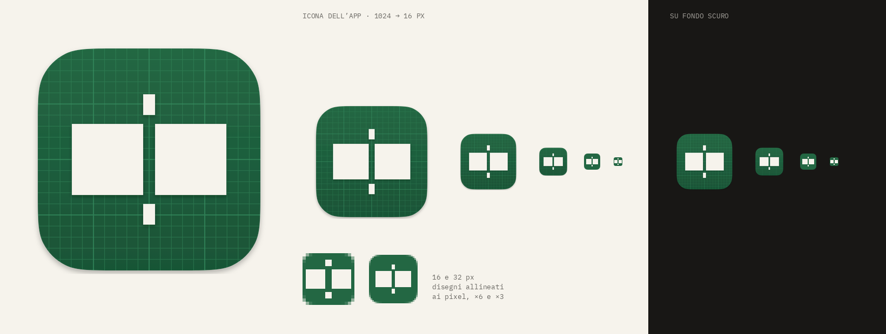

# Impaginatore — Manuale di marca

Versione 1.0 · novembre 2026 · Compito T-005 del piano.
Pagina dimostrativa: [`anteprima.html`](anteprima.html) (chiaro e scuro). Indice dei file e regole rapide: [`README.md`](README.md).



**Indice**

1. [Essenza della marca](#1-essenza-della-marca)
2. [Da chi ci distinguiamo, da chi impariamo](#2-da-chi-ci-distinguiamo-da-chi-impariamo)
3. [Payoff](#3-payoff)
4. [Tono di voce](#4-tono-di-voce)
5. [Lessico](#5-lessico)
6. [Messaggi chiave](#6-messaggi-chiave)
7. [Logo](#7-logo)
8. [Icona dell’app e favicon](#8-icona-dellapp-e-favicon)
9. [Colore](#9-colore)
10. [Tipografia](#10-tipografia)
11. [Griglia e spaziature](#11-griglia-e-spaziature)
12. [Raggi e ombre](#12-raggi-e-ombre)
13. [Icone](#13-icone)
14. [Fotografia e schermate](#14-fotografia-e-schermate)
15. [Movimento](#15-movimento)
16. [Componenti](#16-componenti)
17. [L’app: come differenziarla](#17-lapp-come-differenziarla)
18. [File, strumenti, verifiche](#18-file-strumenti-verifiche)

---

## 1. Essenza della marca

**Promessa.** Album rifiniti al decimo di millimetro, senza cedere né le foto né il lavoro.

**Posizionamento in una frase.** Per i fotografi di matrimonio che vogliono album impaginati a regola d’arte, Impaginatore è il programma che lavora sul loro computer, prepara la bozza con Claude e lascia a loro l’ultima parola; a differenza di SmartAlbums e Fundy Designer, si paga una volta e le foto non escono mai dal disco.

**Valori.**

| Valore | Che cosa significa in pratica |
|---|---|
| Mestiere | Le misure sono vere (mm, dpi, abbondanze), i modelli sono d’autore, il PSD esce a livelli. Mai «più o meno». |
| Proprietà | Le foto restano tue, la licenza resta tua, il progetto si apre anche fra dieci anni. |
| Calma | Nessuna fretta artificiale, nessuna promessa miracolosa. Il programma fa il lavoro ripetitivo e lascia in pace chi decide. |
| Precisione | Ogni numero si può verificare. Se una spaziatura non torna, lo diciamo, in ocra. |
| Italianità sobria | Fatto in Italia da un fotografo: si sente nel gusto editoriale, non nei tricolori. |

**Personalità.** Un collega esperto di bottega: parla poco e preciso, sa le misure a memoria, ti mostra come si fa invece di vantarsi. Non è un venditore, non è un guru della tecnologia, non è un romantico del «giorno più bello».

**A chi parliamo.**

- *Fotografi di matrimonio e cerimonia* (primo pubblico): professionisti, spesso titolari di uno studio piccolo, 20–60 album l’anno. Sanno di stampa, hanno gusto editoriale, diffidano degli abbonamenti e del cloud per le foto dei clienti. Molti usano SmartAlbums, Fundy Designer o InDesign.
- *Laboratori di stampa di album* (secondo pubblico): vogliono file conformi alle loro specifiche e fotografi fedeli al loro catalogo. Ricevono un’edizione personalizzata del programma.

## 2. Da chi ci distinguiamo, da chi impariamo

Osservazioni del 15/11/2026 sui siti ufficiali; le schermate dei siti di terzi non sono archiviate nel repository.

| Marca | Colore | Logo | Linguaggio | Noi facciamo il contrario |
|---|---|---|---|---|
| SmartAlbums (Pixellu) | Grigio chiaro e **giallo** acceso per le azioni | Monogramma «sa» in un **cerchio** | «Design Beautiful Albums in 30 Minutes or Less», «world’s easiest», «busy photographers» | Niente giallo, niente cerchi, niente promesse di minuti |
| Fundy Designer | **Blu notte/petrolio**, **arancio bruciato** per le azioni, corsivo azzurro | «F» disegnata **a filo in prospettiva** | «Biggest Savings», «Lock In Your Price», «One subscription. Two platforms» | Niente arancio né blu notte, niente disegno al tratto in prospettiva, niente urgenza da saldi |
| Graphistudio (laboratorio) | **Rosso** pieno | Lettering con «S» rossa | «Handcrafted in Italy», serif corsivo | Niente rosso come colore di marca, niente corsivo celebrativo |
| Aftershoot (IA per fotografi) | Fondi scuri, **sfumature arcobaleno**, blu | — | «You shoot. Aftershoot handles the rest.» | Niente sfumature, niente «ci pensa l’IA» |
| Zno | **Turchese**, banner arancio | Lettering geometrico | Promozioni e sconti | — |

Restano liberi, nel settore, il **verde** e il **bianco e nero editoriale**. Li prendiamo entrambi.

Dai marchi di riferimento per qualità (Linear, Things, iA Writer, Teenage Engineering, Capture One, Sketch, Panic, Darkroom, Affinity) prendiamo sei principi, non lo stile:

1. **Un oggetto solo.** Things è una spunta, Sketch un diamante, iA Writer un cursore. Il nostro oggetto è lo spread con i segni di piega.
2. **Un colore che fa da segnale.** Teenage Engineering usa l’arancio solo dove serve, iA Writer solo il cursore blu. Noi il Verde Bottega, al 5 %.
3. **La tipografia è la voce.** iA e Linear si riconoscono dal testo prima che dal logo. Noi da Newsreader e dai numeri in IBM Plex Mono.
4. **Il prodotto è l’eroe.** Linear e Capture One mostrano l’interfaccia vera. Noi mostriamo spread veri, con le misure.
5. **Parlare come chi il lavoro lo fa.** Teenage Engineering scrive come un manuale tecnico; Things con calma. Noi come un collega di bottega.
6. **Coerenza nei dettagli piccoli.** Icone, numeri, virgole decimali, apostrofi: è lì che un artigiano riconosce un altro artigiano.

## 3. Payoff

| | Italiano | Inglese | Cosa dice |
|---|---|---|---|
| A | **Resta tuo.** | **Yours to keep.** | Proprietà: licenza, foto, album |
| B | Al decimo di millimetro. | To a tenth of a millimetre. | Precisione |
| C | La bozza è automatica. La firma è tua. | The draft is automatic. The signature is yours. | Automazione e mano dell’autore |

**Scelto: A — «Resta tuo.» / «Yours to keep.»** Due parole che tengono insieme le tre differenze che contano: la licenza si paga una volta e resta tua; le foto restano sul tuo computer; l’album che consegni resta, per la coppia, per sempre. È l’opposto esatto di abbonamento e cloud, i due modelli dei concorrenti, senza nominarli. In inglese «Yours to keep» è un’espressione idiomatica che significa proprio «da tenere, non in prestito». B e C restano come titoli di campagna: B per la precisione, C per presentare l’assistente.

Composizione: Newsreader, punto finale compreso, in Verde Bottega o Inchiostro. Mai in maiuscolo, mai tra virgolette.

## 4. Tono di voce

**Regole.**

- Diamo del tu. Frasi brevi, verbo attivo, soggetto chiaro: chi fa cosa.
- Numeri veri al posto degli aggettivi: «3,0 mm», non «perfetto».
- Nessun punto esclamativo, nessuna emoji, nessun maiuscolo urlato.
- L’assistente si chiama col suo nome: «Claude prepara la bozza». Non «l’IA crea», non «magia».
- Si spiega il perché in una riga, poi ci si ferma.
- Convenzioni italiane: virgola decimale (3,0 mm), punto delle migliaia (1.290 €), prezzo con lo spazio prima di € (89 €), segno di moltiplicazione con spazi (30 × 30 cm), lineetta per gli intervalli (spread 07–08), virgolette basse («»), apostrofo tipografico (’). In inglese: €89, 30 × 30 cm, 3.0 mm.

| Si dice | Non si dice |
|---|---|
| Le foto restano sul tuo computer. | Privacy-first, 100% sicuro, cloud-free! |
| Paghi una volta. La versione che compri resta tua. | Offerta lifetime imperdibile 🔥 |
| Se il problema è del programma, non paghi. L’assistenza personale è a ore, pagata in anticipo. | Supporto premium prioritario 24/7 |
| Claude prepara la bozza; tu decidi ogni spread. | La nostra AI rivoluzionaria crea album magici in un click ✨ |
| Spazi uguali al decimo di millimetro. | Layout pixel-perfect da sogno. |
| Nello spread 07–08 un volto cade a 4 mm dalla piega. | Ops! Qualcosa non va nel tuo layout 😅 |
| Un modello d’autore per lo spread di apertura. | Template stunning per il giorno più bello della loro vita. |
| Esporta anche il PSD a livelli, se vuoi ritoccare in Photoshop. | Workflow seamless con Photoshop. |
| Il laboratorio chiede almeno 3,0 mm di abbondanza. | Errore! Bleed non valido. |

**Inglese.** Stesso tono, frasi ancora più corte. «Your photos stay on your computer.» «Pay once. Keep the version you bought.» «Claude drafts the album; you decide every spread.»

## 5. Lessico

**Parole nostre.** spread · piega · margine · spazio tra le foto · abbondanza · rifilo · segni di taglio · formato · modello (d’autore) · bozza · rifinire · impaginare · consegnare · laboratorio · catalogo · carta · copertina · PSD a livelli · licenza perpetua · sul tuo computer · al decimo di millimetro · bottega · mestiere.

In inglese: spread · gutter · margin · spacing · bleed · trim · crop marks · layout · draft · refine · lab · catalogue · layered PSD · perpetual licence · on your computer.

**Parole vietate.** rivoluzionario · magico/magia · in un click · facilissimo · il migliore al mondo · imperdibile · ultimi posti · potenziato dall’IA · l’IA crea/decide (l’IA come soggetto) · intelligenza artificiale come argomento di vendita · seamless · game changer · workflow (→ lavoro, flusso) · template (→ modello) · cloud (solo per dire che non lo usiamo) · sogno · favola · il giorno più bello · emozioni (usata a vuoto) · emoji · punti esclamativi.
In inglese: magic · effortless · stunning · unleash · elevate · next-level · AI-powered · revolutionary · lifetime deal · in seconds.

**Nomi di terzi.** «Claude» è un marchio di Anthropic: si scrive «funziona con Claude», «Claude prepara la bozza tramite MCP». Non si accosta il logo di Claude al nostro come se fosse una collaborazione. Photoshop, InDesign, SmartAlbums e Fundy Designer si nominano solo per compatibilità o confronti verificabili, mai nel logo né nei titoli.

## 6. Messaggi chiave

**Per i fotografi.**

1. **Le foto restano sul tuo computer.** Nessuna funzione le carica in rete; si lavora anche senza connessione. *Prova:* regola del progetto, verificata dall’audit di sicurezza.
2. **Paghi una volta.** Licenza perpetua: la versione che compri resta tua, anche se smetti di aggiornare. *Prova:* attivazione con chiave verificata in locale. L’assistenza personale è a parte, a ore e facoltativa: si dice chiaro accanto al prezzo, non in piccolo.
3. **Precisione da tipografo.** Spazi e margini uguali al decimo di millimetro, controllati spread per spread; modelli d’autore; PSD a livelli per Photoshop.
4. **La bozza la prepara Claude, la rifinitura è tua.** L’assistente costruisce l’intero album dentro l’editor; gli spread che hai rifinito a mano non vengono più toccati.
5. **Fatto da un fotografo.** Nasce dal banco di lavoro di chi impagina album da più di dieci anni e non voleva perdere il proprio strumento.

**Per i laboratori.**

1. **Il tuo catalogo dentro il programma.** Formati, carte, copertine: il fotografo sceglie la configurazione e impagina già nel tuo formato.
2. **File conformi alle tue specifiche.** Abbondanze, piega, profili colore e nomi dei file come li vuoi tu: meno rifacimenti, meno telefonate.
3. **Il tuo nome accanto al nostro.** Edizione personalizzata: «Impaginatore · Edizione [nome del laboratorio]».
4. **Nessun server in mezzo.** Le foto non passano da noi: i file arrivano a te come oggi.
5. **Un argomento in più per sceglierti.** I tuoi clienti ricevono uno strumento che non si paga ogni anno.

**Composizione con il marchio di un laboratorio.** Logotipo Impaginatore, filetto verticale da 1 px in Inchiostro alto quanto le pagine del simbolo, logo del laboratorio alla stessa altezza ottica. Distanza dal filetto: 6u per lato (vedi §7). Il marchio del laboratorio non si fonde col nostro e non ne prende i colori.

## 7. Logo

### Tre concept



| | Idea | Perché sì | Perché no |
|---|---|---|---|
| **1 · La Piega — scelto** | Lo spread visto dall’alto: due pagine quadrate e i segni di piega del tipografo sopra e sotto la piega. La linea segno–piega–segno è la I di Impaginatore. | Racconta il punto più delicato dell’album (nessun volto nella piega, margini che tornano ai due lati); si legge a 16 px; nessun concorrente usa pagine piene o segni di stampa. | Due quadrati da soli sono un segno semplice: la forza sta nei segni di piega, che vanno sempre mantenuti. |
| 2 · Il Crocino | I segni di taglio attorno a una I: precisione di stampa e mirino della fotocamera nello stesso segno. | Doppia lettura per un fotografo che stampa. | Sotto i 32 px diventa polvere; ricorda l’icona «cattura schermo» di molti sistemi. Resta come **motivo grafico** (i crocini attorno a foto e card). |
| 3 · L’Angolino | Gli angoli portafoto degli album di una volta. | Caldo, riconoscibile da chi fa matrimoni. | Guarda indietro: parla di album incollati, non di impaginazione né di precisione. |

La prima versione della Piega (`logo/concept/concept-1a-scartato-i-in-negativo.svg`) ricavava la I in negativo tra le pagine: a colpo d’occhio sembrava una trave o una porta doppia. I segni di piega dicono la stessa cosa in modo più leggero e più nostro.

### Costruzione

Griglia di unità **u** (nei file: u = 10).

| Elemento | Misura |
|---|---|
| Pagina | 12u × 12u |
| Piega (spazio tra le pagine) | 2u |
| Distacco tra pagina e segno | 1,5u |
| Segno di piega | 2u × 3,5u |
| Ingombro del simbolo | 26u × 22u |
| Logotipo | Altezza della maiuscola della parola = lato della pagina (12u); linea di base = piede delle pagine; distanza simbolo–parola 7u |
| Verticale | Simbolo a scala 2, parola centrata sotto; distanza 12u (unità del simbolo piccolo) |

La parola è composta in **Newsreader** (peso 540, dimensione ottica 72, spaziatura −1 %, crenatura del carattere) e convertita in tracciati: i file non dipendono da alcun font. Unico intervento di disegno: **il punto della «i» è un quadrato**, come le pagine del simbolo.

### Area di rispetto e dimensioni minime

- **Area di rispetto: 6u** (mezza pagina) su tutti i lati dell’ingombro, segni di piega compresi. Nel logotipo alto 24 px, 6u ≈ 6,5 px; si arrotonda per eccesso.
- **Dimensioni minime.**

| Versione | Schermo | Stampa |
|---|---|---|
| Simbolo | 16 px (sotto i 24 px usa `impaginatore-simbolo-16.svg`, allineato ai pixel) | 5 mm |
| Logotipo | 24 px di altezza (≈ 149 px di larghezza) | 7 mm di altezza |
| Verticale | 64 px di altezza | 18 mm di altezza |



### Versioni e fondi

| File (in `logo/`) | Quando |
|---|---|
| `impaginatore-{simbolo,logotipo,verticale}.svg` | **Colore**: pagine e parola Inchiostro, segni Verde Bottega. Su Carta, bianco, foto chiare. |
| `…-negativo.svg` | **Colore in negativo**: pagine e parola Carta, segni Verde Bottega chiaro. Su Inchiostro e foto scure. |
| `…-mono-scuro.svg` | Tutto Inchiostro. Stampa a un colore, timbri, incisioni, documenti. |
| `…-mono-chiaro.svg` | Tutto bianco. Su foto movimentate, su Verde Bottega, a secco o a caldo sulle copertine. |
| `impaginatore-simbolo-16*.svg` | Simbolo allineati ai pixel per 16 × 13 px (barre dell’app, menu). |

Il logotipo orizzontale è la versione principale. Il verticale si usa dove lo spazio è quadrato (copertine, social, stand). Il simbolo da solo si usa quando la marca è già nota nel contesto (app, favicon, avatar).

### Usi scorretti

Non deformare. Non cambiare i colori né aggiungere sfumature. Non ruotare. Niente ombre, bagliori o rilievi. Non ricomporre il nome con un altro carattere. A colori i segni di piega sono sempre verdi (mai Inchiostro accanto a pagine Inchiostro, salvo nella versione monocroma). Non su foto senza contrasto: usa il negativo o il monocromo chiaro. Non alterare proporzioni e distanze tra simbolo e parola. Esempi visivi in `anteprima.html`, sezione Marchio.

## 8. Icona dell’app e favicon



Lo spread con i segni di piega, in Carta, appoggiato sul **tappetino da taglio** Verde Bottega con la sua griglia a centimetri (linea più marcata ogni cinque). Forma ad angoli continui sulla griglia macOS (824 × 824 px su 1024, raggio 22,5 %, smussatura 60 %), ombra di sistema leggera.

- `icona/icona-1024.svg` è l’originale; i PNG 64–1024 sono resi con Chrome e ridotti con Lanczos.
- 16 e 32 px hanno disegni propri allineati ai pixel (`icona-16.svg`, `icona-piccola.svg`): la griglia del tappetino sparisce, pagine e segni cadono su pixel interi.
- `icona.ico` (Windows) contiene 16, 24, 32, 48, 64, 128, 256 px; `icona.icns` (macOS) contiene tutte le voci PNG da 16 a 1024 px, comprese le @2x. Su un Mac si può rigenerare con `strumenti/crea_icns_mac.sh`.
- macOS 26: per l’icona a livelli di Icon Composer usare `icona/livelli/fondo.svg` e `icona/livelli/segno.svg`.
- Favicon: `icona/favicon.svg` (vettoriale, griglia 32) e `icona/favicon-32.png`.

## 9. Colore

Il colore lo portano le foto. La marca resta sul bianco e nero di una bozza di stampa, con un solo accento: il **Verde Bottega**, il verde del tappetino da taglio che sta su ogni banco da lavoro di chi taglia carta. Nessun concorrente lo usa; è calmo, sicuro, artigiano, e lontano dal giallo di SmartAlbums, dall’arancio e dal blu notte di Fundy, dal rosso di Graphistudio e dal viola «IA».

**Proporzioni indicative:** 70 % Carta · 25 % Inchiostro · 5 % Verde Bottega. Il verde segna ciò che si può fare (un pulsante primario per schermata, un link, il fuoco) e ciò che è a posto (una misura giusta). Mai sfumature di marca, mai il verde come fondo di intere pagine del sito (eccezioni: icona dell’app, piccole superfici promozionali).

**Nell’app, attorno alle foto, solo grigi neutri (C = 0).** Una tinta calda o fredda attorno a una foto altera il giudizio sul colore; per questo esiste la scala `grigio`, separata dalla scala `carta`.

### Valori

Fonte unica: `strumenti/genera_token.py`, dove i colori sono definiti in OKLCH e convertiti in sRGB. La tabella qui sotto è generata dallo script.

<!-- palette:inizio -->
| Token | Nome | HEX | RGB | OKLCH | Uso |
|---|---|---|---|---|---|
| `--imp-carta-0` | Bianco carta | `#FDFCF9` | 253 252 249 | `oklch(99.0% 0.004 85)` | Superfici sollevate, card |
| `--imp-carta-50` | Carta | `#F6F3EC` | 246 243 236 | `oklch(96.5% 0.010 85)` | Fondo pagina, colore primario chiaro |
| `--imp-carta-100` | Velina | `#EDE9E1` | 237 233 225 | `oklch(93.5% 0.011 85)` | Riempimenti tenui, righe alterne |
| `--imp-carta-200` | Cartoncino | `#DEDAD2` | 222 218 210 | `oklch(89.0% 0.012 85)` | Filetti e divisori |
| `--imp-carta-300` | Feltro | `#C7C4BC` | 199 196 188 | `oklch(82.0% 0.011 85)` | Bordi decorativi; testo secondario su scuro |
| `--imp-carta-400` | Cenere | `#A19E98` | 161 158 152 | `oklch(70.0% 0.010 85)` | Testo tenue su scuro |
| `--imp-carta-500` | Piombo | `#6B6964` | 107 105 100 | `oklch(52.0% 0.008 85)` | Testo tenue su chiaro; bordi dei campi |
| `--imp-carta-600` | Ardesia | `#54524E` | 84 82 78 | `oklch(44.0% 0.007 85)` | Testo secondario su chiaro |
| `--imp-carta-700` | Grafite | `#3E3D3A` | 62 61 58 | `oklch(36.0% 0.006 85)` | Bordi su scuro |
| `--imp-carta-800` | Fumo | `#292725` | 41 39 37 | `oklch(27.5% 0.005 85)` | Superfici sollevate su scuro |
| `--imp-carta-900` | Inchiostro | `#181715` | 24 23 21 | `oklch(20.5% 0.005 85)` | Testo, colore primario scuro, fondo scuro |
| `--imp-carta-950` | Nero seppia | `#0F0E0C` | 15 14 12 | `oklch(16.5% 0.004 85)` | Fondo più profondo, ombre |
| `--imp-verde-50` | Verde velina | `#ECF9F0` | 236 249 240 | `oklch(97.0% 0.018 157)` | Fondo di badge e avvisi positivi |
| `--imp-verde-300` | Verde Bottega chiaro | `#7BCC9C` | 123 204 156 | `oklch(78.0% 0.105 157)` | Accento e link su fondo scuro |
| `--imp-verde-600` | Verde Bottega | `#236743` | 35 103 67 | `oklch(46.0% 0.090 157)` | Accento: pulsante primario, link, fuoco |
| `--imp-verde-900` | Verde profondo | `#0B2B1A` | 11 43 26 | `oklch(26.0% 0.050 157)` | Fondo dell'icona in ombra |
| `--imp-ocra-500` | Ocra | `#C78B28` | 199 139 40 | `oklch(68.0% 0.130 75)` | Indicatori di attenzione |
| `--imp-ocra-600` | Ocra scura | `#845A0F` | 132 90 15 | `oklch(50.0% 0.100 75)` | Testo di attenzione su chiaro |
| `--imp-cinabro-600` | Cinabro | `#B6322B` | 182 50 43 | `oklch(52.0% 0.170 28)` | Errore, azioni distruttive |
| `--imp-blu-600` | Blu di Prussia | `#2A669F` | 42 102 159 | `oklch(50.0% 0.110 250)` | Informazione, misure neutre |
| `--imp-grigio-50` | — | `#F5F5F5` | 245 245 245 | `oklch(97.0% 0.000 0)` | Pannelli app, tema chiaro |
| `--imp-grigio-100` | — | `#E8E8E8` | 232 232 232 | `oklch(93.0% 0.000 0)` | — |
| `--imp-grigio-200` | — | `#D4D4D4` | 212 212 212 | `oklch(87.0% 0.000 0)` | Bordi app chiara |
| `--imp-grigio-300` | — | `#B7B7B7` | 183 183 183 | `oklch(78.0% 0.000 0)` | Testo secondario app scura |
| `--imp-grigio-400` | — | `#989898` | 152 152 152 | `oklch(68.0% 0.000 0)` | Testo tenue app scura |
| `--imp-grigio-500` | Grigio medio | `#747474` | 116 116 116 | `oklch(56.0% 0.000 0)` | Tela neutra per giudicare il colore |
| `--imp-grigio-600` | — | `#5B5B5B` | 91 91 91 | `oklch(47.0% 0.000 0)` | Testo tenue app chiara |
| `--imp-grigio-700` | — | `#424242` | 66 66 66 | `oklch(38.0% 0.000 0)` | Bordi app scura |
| `--imp-grigio-800` | — | `#303030` | 48 48 48 | `oklch(31.0% 0.000 0)` | Pannelli sollevati app scura |
| `--imp-grigio-850` | — | `#262626` | 38 38 38 | `oklch(27.0% 0.000 0)` | Pannelli app scura |
| `--imp-grigio-900` | — | `#1E1E1E` | 30 30 30 | `oklch(23.5% 0.000 0)` | Tela app scura |
| `--imp-grigio-950` | — | `#141414` | 20 20 20 | `oklch(19.0% 0.000 0)` | Barra superiore app scura |
<!-- palette:fine -->

Scale complete (anche i gradini senza nome) in `tokens.css` e `tokens.json`.

### Modalità chiara e scura

I componenti usano solo i **token di tema**; i primitivi servono a definirli.

| Token di tema | Chiaro | Scuro | Uso |
|---|---|---|---|
| `--imp-fondo` | carta-50 Carta | carta-900 Inchiostro | Fondo pagina |
| `--imp-fondo-tenue` | carta-100 Velina | carta-950 Nero seppia | Fasce alterne |
| `--imp-superficie` | carta-0 Bianco carta | carta-800 Fumo | Card, campi, pannelli |
| `--imp-testo` | carta-900 | carta-50 | Testo |
| `--imp-testo-secondario` | carta-600 Ardesia | carta-300 Feltro | Sottotitoli |
| `--imp-testo-tenue` | carta-500 Piombo | carta-400 Cenere | Note, segnaposto |
| `--imp-filetto` | carta-200 | carta-700 | Divisori |
| `--imp-bordo-campo` | carta-500 | carta-400 | Bordi dei controlli (≥ 3:1) |
| `--imp-accento` | verde-600 | verde-300 | Link, fuoco, segni |
| `--imp-accento-fondo` / `--imp-su-accento` | verde-600 / carta-50 | verde-400 / carta-950 | Pulsante primario |
| `--imp-successo` · `--imp-attenzione` · `--imp-errore` · `--imp-info` | verde-600 · ocra-600 · cinabro-600 · blu-600 | verde-300 · ocra-300 · cinabro-300 · blu-300 | Stati |
| `--imp-app-tela` · `--imp-app-pannello` · `--imp-app-bordo` | grigio-100 · grigio-50 · grigio-200 | grigio-900 · grigio-850 · grigio-700 | Area di lavoro dell’app |
| `--imp-app-selezione` | carta-900 | bianco | Contorno della selezione |

Il tema si sceglie con `prefers-color-scheme` o forzandolo con `data-theme="light"` / `data-theme="dark"` sull’elemento radice.

**Nota sul verde.** Il verde di marca coincide col verde di «successo»: è voluto (verde = a posto), ma quindi il verde non si usa mai per decorare un messaggio d’errore o di attenzione, e un pulsante verde non deve mai avviare un’azione distruttiva.

### Contrasti (WCAG 2.2, calcolati)

Calcolati da `strumenti/genera_token.py` con la formula WCAG 2.2 sulla luminanza relativa sRGB; lo script si ferma se una coppia scende sotto la soglia. Soglie: testo 4,5:1 (AA) e 7:1 (AAA); bordi dei controlli ed elementi grafici 3:1.

<!-- contrasti:inizio -->
| Tema | Primo piano | Fondo | Uso | Rapporto | Soglia | Esito |
|---|---|---|---|---|---|---|
| chiaro | `carta-900` #181715 | `carta-50` #F6F3EC | Testo su Carta | **16,17:1** | 4,50:1 | AAA |
| chiaro | `carta-900` #181715 | `carta-0` #FDFCF9 | Testo su card | **17,46:1** | 4,50:1 | AAA |
| chiaro | `carta-600` #54524E | `carta-50` #F6F3EC | Testo secondario su Carta | **7,03:1** | 4,50:1 | AAA |
| chiaro | `carta-500` #6B6964 | `carta-50` #F6F3EC | Testo tenue su Carta | **4,95:1** | 4,50:1 | AA |
| chiaro | `carta-500` #6B6964 | `carta-100` #EDE9E1 | Testo tenue su Velina | **4,53:1** | 4,50:1 | AA |
| chiaro | `verde-600` #236743 | `carta-50` #F6F3EC | Link verde su Carta | **6,13:1** | 4,50:1 | AA |
| chiaro | `carta-50` #F6F3EC | `verde-600` #236743 | Testo del pulsante primario | **6,13:1** | 4,50:1 | AA |
| chiaro | `carta-50` #F6F3EC | `verde-700` #195436 | Pulsante primario premuto | **8,02:1** | 4,50:1 | AAA |
| chiaro | `verde-600` #236743 | `verde-50` #ECF9F0 | Badge positivo | **6,26:1** | 4,50:1 | AA |
| chiaro | `ocra-600` #845A0F | `carta-50` #F6F3EC | Attenzione su Carta | **5,49:1** | 4,50:1 | AA |
| chiaro | `ocra-600` #845A0F | `ocra-50` #FBF3E1 | Avviso di attenzione | **5,51:1** | 4,50:1 | AA |
| chiaro | `cinabro-600` #B6322B | `carta-50` #F6F3EC | Errore su Carta | **5,45:1** | 4,50:1 | AA |
| chiaro | `carta-50` #F6F3EC | `cinabro-600` #B6322B | Pulsante distruttivo | **5,45:1** | 4,50:1 | AA |
| chiaro | `blu-600` #2A669F | `carta-50` #F6F3EC | Informazione su Carta | **5,41:1** | 4,50:1 | AA |
| chiaro | `carta-500` #6B6964 | `carta-0` #FDFCF9 | Bordo dei campi (non testo) | **5,34:1** | 3,00:1 | ≥ 3:1 |
| chiaro | `verde-600` #236743 | `carta-0` #FDFCF9 | Anello di fuoco (non testo) | **6,62:1** | 3,00:1 | ≥ 3:1 |
| scuro | `carta-50` #F6F3EC | `carta-900` #181715 | Testo su Inchiostro | **16,17:1** | 4,50:1 | AAA |
| scuro | `carta-50` #F6F3EC | `carta-800` #292725 | Testo su card scura | **13,43:1** | 4,50:1 | AAA |
| scuro | `carta-300` #C7C4BC | `carta-900` #181715 | Testo secondario su Inchiostro | **10,28:1** | 4,50:1 | AAA |
| scuro | `carta-400` #A19E98 | `carta-900` #181715 | Testo tenue su Inchiostro | **6,70:1** | 4,50:1 | AA |
| scuro | `carta-400` #A19E98 | `carta-800` #292725 | Testo tenue su card scura | **5,57:1** | 4,50:1 | AA |
| scuro | `verde-300` #7BCC9C | `carta-900` #181715 | Link verde su Inchiostro | **9,35:1** | 4,50:1 | AAA |
| scuro | `carta-950` #0F0E0C | `verde-400` #5AB481 | Testo del pulsante primario | **7,61:1** | 4,50:1 | AAA |
| scuro | `verde-300` #7BCC9C | `verde-900` #0B2B1A | Badge positivo | **7,97:1** | 4,50:1 | AAA |
| scuro | `ocra-300` #EABC6E | `carta-900` #181715 | Attenzione su Inchiostro | **10,17:1** | 4,50:1 | AAA |
| scuro | `cinabro-300` #F2897C | `carta-900` #181715 | Errore su Inchiostro | **7,37:1** | 4,50:1 | AAA |
| scuro | `blu-300` #88B9EC | `carta-900` #181715 | Informazione su Inchiostro | **8,70:1** | 4,50:1 | AAA |
| scuro | `carta-400` #A19E98 | `carta-800` #292725 | Bordo dei campi (non testo) | **5,57:1** | 3,00:1 | ≥ 3:1 |
| app | `grigio-50` #F5F5F5 | `grigio-850` #262626 | Testo dei pannelli (app scura) | **13,88:1** | 4,50:1 | AAA |
| app | `grigio-400` #989898 | `grigio-850` #262626 | Etichette dei pannelli (app scura) | **5,25:1** | 4,50:1 | AA |
| app | `verde-300` #7BCC9C | `grigio-850` #262626 | Accento nei pannelli (app scura) | **7,90:1** | 4,50:1 | AAA |
| app | `carta-900` #181715 | `grigio-50` #F5F5F5 | Testo dei pannelli (app chiara) | **16,43:1** | 4,50:1 | AAA |
| app | `grigio-600` #5B5B5B | `grigio-50` #F5F5F5 | Etichette dei pannelli (app chiara) | **6,23:1** | 4,50:1 | AA |
| app | `bianco` #FFFFFF | `grigio-900` #1E1E1E | Contorno di selezione su tela (non testo) | **16,67:1** | 3,00:1 | ≥ 3:1 |
| marchio | `carta-900` #181715 | `carta-50` #F6F3EC | Logo a colori: pagine su Carta | **16,17:1** | 3,00:1 | ≥ 3:1 |
| marchio | `verde-600` #236743 | `carta-50` #F6F3EC | Logo a colori: segni di piega su Carta | **6,13:1** | 3,00:1 | ≥ 3:1 |
| marchio | `verde-300` #7BCC9C | `carta-900` #181715 | Logo negativo: segni su Inchiostro | **9,35:1** | 3,00:1 | ≥ 3:1 |
| marchio | `carta-50` #F6F3EC | `verde-600` #236743 | Icona: pagine su Verde Bottega | **6,13:1** | 3,00:1 | ≥ 3:1 |
<!-- contrasti:fine -->

Coppie da evitare: Verde Bottega su Inchiostro (2,6:1 circa) per il testo; Piombo su Velina sotto i 14 px (4,53:1 è al limite); Ocra 500 per il testo (solo per guide e indicatori).

## 10. Tipografia

Tre caratteri, tre compiti. Tutti con **SIL Open Font License 1.1**: uso commerciale libero, incorporabili nell’app, nei PDF e nel sito, ridistribuibili insieme al software; non si vendono da soli e non si rinominano se modificati. File e licenze in `font/`; dichiarazioni `@font-face` pronte in `font/font.css`; per il sito vanno bene anche da Google Fonts.

| Ruolo | Famiglia | Autori e licenza | Assi |
|---|---|---|---|
| **Titoli** e logotipo | **Newsreader** | © 2020 The Newsreader Project Authors (Production Type, Hugues Gentile) — SIL OFL 1.1 (`font/OFL-Newsreader.txt`) | peso 200–800, dimensione ottica 6–72, corsivo |
| **Testo e interfaccia** | **Instrument Sans** | © 2022 The Instrument Sans Project Authors (Rodrigo Fuenzalida, Jordan Egstad) — SIL OFL 1.1 (`font/OFL-InstrumentSans.txt`) | peso 400–700, larghezza 75–100 % |
| **Numeri, misure, etichette** | **IBM Plex Mono** | © 2017 IBM Corp., nome riservato «Plex» — SIL OFL 1.1 (`font/OFL-IBMPlexMono.txt`) | Regular 400, Medium 500 |

Licenze verificate sui file `OFL.txt` e `METADATA.pb` del repository ufficiale Google Fonts (`github.com/google/fonts`, cartelle `ofl/newsreader`, `ofl/instrumentsans`, `ofl/ibmplexmono`) il 15/11/2026. Attenzione al **nome riservato «Plex»**: se si crea un sottoinsieme o si modifica IBM Plex Mono, la versione modificata va rinominata. I `.woff2` in `font/` sono conversioni di formato senza modifiche ai glifi.

**Perché questi.** Newsreader è un carattere da giornale e da libro con dimensioni ottiche vere: robusto, non il serif sottile da partecipazione di nozze (il Cormorant di Fundy, il corsivo di Graphistudio). Instrument Sans è un lineare caldo e compatto, con cifre tabellari e una larghezza ridotta utile nei pannelli dell’app. IBM Plex Mono dà ai numeri la voce di un righello e richiama la macchina da scrivere: lo zero senza barra non si confonde col simbolo di diametro.

### Scala

| Stile | Carattere | px / interlinea | Peso | Spaziatura | Note |
|---|---|---|---|---|---|
| Display | Newsreader | 72 / 1,02 | 480 | −2,2 % | `opsz` 72; payoff, copertine |
| Titolo 1 | Newsreader | 52 / 1,06 | 480 | −1,8 % | `opsz` 60 |
| Titolo 2 | Newsreader | 38 / 1,12 | 500 | −1,2 % | `opsz` 48 |
| Titolo 3 | Newsreader | 28 / 1,2 | 500 | −0,8 % | `opsz` 32 |
| Titolo 4 | Instrument Sans | 20 / 1,3 | 600 | −0,6 % | Titoli di card |
| Attacco | Instrument Sans | 19 / 1,5 | 400 | −0,4 % | Primo paragrafo |
| Testo | Instrument Sans | 16 / 1,6 | 400 | 0 | Misura 60–70 caratteri |
| Piccolo | Instrument Sans | 14 / 1,5 | 400 | 0 | |
| Didascalia | Instrument Sans | 12,5 / 1,4 | 400 | +0,4 % | |
| Etichetta | IBM Plex Mono | 11,5 / 1,3 | 500 | +6 % | MAIUSCOLO, sezioni e dati tecnici |
| Misura | IBM Plex Mono | 13 / 1,3 | 400 | 0 | Cifre tabellari |
| App: testo · etichetta · misura | Instrument Sans · Instrument Sans · IBM Plex Mono | 13 · 11 · 12 | 400 · 600 · 400 | | Pannelli dell’app |

Sotto i 40 px la dimensione ottica di Newsreader segue la dimensione del testo (`font-optical-sizing: auto`). Niente maiuscolo per i titoli. Corsivo di Newsreader solo per una parola o una citazione, mai per titoli interi. I prezzi grandi si compongono in Newsreader con cifre allineate; nelle tabelle e nei badge in IBM Plex Mono.

## 11. Griglia e spaziature

- **Base 4 px** (2 px solo per dettagli). Scala: 0 · 2 · 4 · 8 · 12 · 16 · 24 · 32 · 48 · 64 · 96 · 128 (`--imp-spazio-0` … `-11`).
- **Web:** 12 colonne, canale 24 px, larghezza massima del contenuto 1200 px, margini laterali `clamp(16px, 5vw, 64px)`. Impaginazione editoriale: etichetta di sezione nelle colonne 1–3, contenuto nelle 4–12, come in `anteprima.html`.
- **Linea di base 8 px** per i ritmi verticali (le interlinee della scala producono multipli di 4 px).
- **Stampa (A4, materiali per laboratori):** 12 colonne; margini interno 15 mm, esterno 20 mm, testa 15 mm, piede 25 mm (proporzioni da libro, piede più ampio).
- **App:** pannelli 188–290 px; righe di 28–32 px; spaziatura interna 12–14 px.

## 12. Raggi e ombre

- **Raggi:** 0 per foto, spread, miniature (la carta si taglia dritta) · 2 px campi e badge · 4 px pulsanti · 8 px card, finestre, menu. Pillola (999 px) solo per gli interruttori.
- **Ombre:** due soltanto. *Appoggio* (carta posata sul tavolo): `0 1px 2px` al 6 % + `0 4px 12px −4px` all’8 %. *Sollevato* (menu, popover, finestre): `0 2px 6px` all’8 % + `0 16px 40px −12px` al 22 %. In scuro le ombre si sostituiscono con un filetto chiaro al 6–8 %. Niente bagliori colorati, niente vetro smerigliato.

## 13. Icone

- Griglia 24 px con 2 px di margine; **tratto 1,5 px**, terminali e angoli **vivi** (come la carta tagliata e i segni di taglio); niente riempimenti, salvo lo stato attivo.
- Linee tratteggiate (2,5/2) per ciò che non si stampa: abbondanza, guide, piega.
- Pittogrammi presi dal mestiere: spread, piega, abbondanza, margine, modelli, livelli PSD, bozza, sul computer, licenza, misura, testo, esporta (12 esempi in `anteprima.html`).
- Per l’assistente: l’icona **bozza** (un foglio con le righe). **Mai scintille, stelline, bacchette magiche, cervelli.**
- Dimensioni: 16 px (tratto 1,25), 20 px, 24 px. Colore: `currentColor`.

## 14. Fotografia e schermate

**Fotografia.**

- Foto vere di matrimoni e cerimonie, scattate da fotografi che lavorano, con liberatoria e licenza per l’uso commerciale. Luce naturale, sguardo documentario, persone di età e provenienze diverse. Niente banca immagini con coppie in posa davanti al portatile.
- L’album come **oggetto**: spread stampati fotografati dall’alto sul tappetino verde, mani che sfogliano, il bordo della carta, la piega, la rilegatura. Luce diurna morbida, bilanciamento neutro.
- Colore fedele: niente preset alla moda (verde-arancio, pastelli lavati), niente grana finta.
- Cliché da evitare: fedi sulla Bibbia, cuori, bokeh di stelline, coriandoli, tramonti di repertorio.

**Schermate.**

- Sempre l’app vera, a 1:1 o 2:1, con **album dimostrativi** costruiti con foto concesse in licenza (compito T-501). Mai foto dei clienti senza consenso scritto.
- Su fondo Carta o Inchiostro, dritte, senza prospettiva 3D, senza cornici di dispositivi lucidi, senza riflessi.
- Si possono annotare con i **crocini** agli angoli e con quote in IBM Plex Mono e Verde Bottega (es. «5,0 mm» tra due foto). Una sola annotazione per schermata, due al massimo.
- Ritaglio sul dettaglio che si racconta (il pannello misure, lo spread con la piega); niente schermate intere ridotte a francobollo.

## 15. Movimento

Come la carta: si sposta in linea retta, si posa, non rimbalza.

| Token | Durata | Per |
|---|---|---|
| `--imp-durata-istante` | 90 ms | Hover, pressione, cambi di colore |
| `--imp-durata-breve` | 160 ms | Interruttori, suggerimenti, menu |
| `--imp-durata-medio` | 240 ms | Pannelli, finestre, cambio di tema |
| `--imp-durata-lungo` | 400 ms | Passaggi tra schermate, comparsa del logo |

Curve: `--imp-curva-esce` (0,2 0 0 1) per ciò che entra, `--imp-curva-entra` (0,4 0 1 1) per ciò che esce, `--imp-curva-standard` (0,4 0 0,2 1) per gli spostamenti. Niente molle, ingrandimenti oltre il 2 %, sfocature in movimento. Con `prefers-reduced-motion` le durate vanno a zero (già in `tokens.css`).

Avanzamento dell’assistente: gli spread compaiono uno alla volta nella colonna di sinistra, con il numero di pagina; niente cerchi che girano né scintille. Animazione del logo (facoltativa, video e avvio): i due segni di piega scendono e salgono fino a toccare la piega, 400 ms, poi compare la parola.

## 16. Componenti

Valgono per sito e app. Specifiche e stati visibili in `anteprima.html`, sezione Componenti.

**Pulsanti.** Altezza 40 px (piccolo 32, grande 48); padding orizzontale 18 px; raggio 4 px; Instrument Sans 600 14,5 px.

| Tipo | Fondo / testo / bordo | Uso |
|---|---|---|
| Primario | `accento-fondo` / `su-accento` / — | **Uno per schermata**: Scarica, Acquista, Esporta |
| Pieno | `inverso-fondo` / `inverso-testo` | Seconda azione forte (Acquista la licenza accanto a Scarica la prova) |
| Secondario | `superficie` / `testo` / `bordo-campo` | Azioni normali |
| Testo | trasparente / `accento`, sottolineato | Azioni minori, link |
| Distruttivo | trasparente / `errore` / `errore` | Elimina, sostituisci. Mai verde. |

Stati: hover (fondo più scuro o bordo `testo`), premuto (spostamento di 1 px in basso), fuoco (anello 2 px `accento`, distacco 2 px), disattivato (opacità 45 %).

**Campi.** Altezza 40 px, raggio 2 px, bordo 1 px `bordo-campo`, fondo `superficie`. Etichetta sopra in 600 13 px; aiuto sotto in 12,5 px `testo-tenue`. I campi numerici sono in IBM Plex Mono, allineati a destra, con l’unità in coda («5,0 mm»). Fuoco: bordo e anello di 1 px `accento`. Errore: bordo `errore` e messaggio che dice cosa fare («Il laboratorio chiede almeno 3,0 mm.»).

**Selettore** (Spread · Modelli · Testi): segmenti con filetto; quello attivo in `inverso`. **Spunte e interruttori:** riempimento `accento-fondo` quando attivi.

**Card.** Fondo `superficie`, filetto 1 px, raggio 8 px, padding 24 px, ombra *appoggio*. Icona in un riquadro 40 × 40 con filetto, colore `accento`. I **crocini** (segni di taglio agli angoli, classe `.crocini`) si usano attorno a foto e card in evidenza, non dappertutto.

**Badge.** 24 px, raggio 2 px, IBM Plex Mono 500 11,5 px maiuscolo. Varianti: neutro (filetto), verde (`accento-tenue` + `accento`).

**Badge prezzo.** Due parti unite: la cifra in IBM Plex Mono su `superficie` con bordo `testo`, e «una volta» su `inverso-fondo`. Il prezzo della licenza non compare mai senza «una volta» (in inglese «one-time»).

**Card prezzo.** Etichetta per chi è (POCHI ALBUM / PROFESSIONISTA / PIÙ POSTAZIONI), nome della fascia in Newsreader 30 px, cifra in Newsreader 64 px con «una volta» accanto, elenco con spunte verdi, pulsante a tutta larghezza in fondo, nota fiscale in 12,5 px. Tre fasce per i fotografi, Essenziale · **Pro** · Studio, con il Pro al centro: bordo `testo`, ombra *sollevato*, badge verde «Consigliato» e l’unico pulsante verde. Sotto le card, una fascia **Assistenza a ore** con i tre pacchetti (1 ora 60 €, 5 ore 250 €, 10 ore 450 €), il prezzo per ora in testo secondario, la validità (12 mesi, blocchi di 30 minuti) e la nota «Gratis per tutti: manuale, guide video e correzione dei difetti». Pulsante neutro, mai verde. L’edizione per i laboratori sta in una fascia a parte sotto, con «Parliamone» e senza cifra. Cifre, funzioni e nomi vengono da `docs/mercato/tier.json` e `prezzi.md` (T-004): se cambiano lì, si cambiano qui.

**Prezzi dell’assistenza.** Si scrivono con l’unità: «60 € l’ora», «5 ore, 250 €». Mai «una volta» (vale solo per la licenza), mai «abbonamento», mai «supporto prioritario»: nessuna fascia lo include. Studio dice «1 ora di assistenza inclusa».

**Prezzo di lancio.** La cifra grande è quella che si paga oggi; il prezzo di listino va accanto in testo secondario con la data di fine («69 € fino al 15 gennaio, poi 89 €»). Niente prezzo barrato finché il listino non è stato davvero applicato: per la direttiva Omnibus (art. 17-bis del Codice del consumo) il prezzo «prima» di uno sconto deve essere il più basso dei 30 giorni precedenti. Da far confermare a chi segue l’aspetto legale.

**Avvisi.** Filetto sinistro di 3 px nel colore dello stato, fondo tinto al 9 %, icona, attacco in grassetto che dice l’esito («Spaziature corrette.», «Da controllare.», «Non esportabile.»).

**Quote.** Linea di misura con terminali e valore in IBM Plex Mono (classe `.quota`): il segno grafico più nostro dopo il logo. Verde se la misura torna, ocra se va controllata.

## 17. L’app: come differenziarla

Oggi l’editor (`src/impaginatore/risorse/index.html`, insieme a `home.html`) usa grigio scuro con accento **giallo-oro** (`--accent: #e0b23c`), rosa acceso per le misure (`#ff3d7f`), colori di sistema Apple e caratteri di sistema: un’impostazione vicina a quella di SmartAlbums, che fa del giallo il suo colore. Per il compito T-205 la direzione è questa (prototipo nella sezione Applicazioni di `anteprima.html`):

| Oggi | Domani | Token |
|---|---|---|
| `--bg #2b2b2b`, `--panel #333`, `--panel2 #3b3b3b`, `--line #4a4a4a` | Tela, pannelli, sollevato, bordi in grigi neutri a C = 0 | `--imp-app-tela`, `--imp-app-pannello`, `--imp-app-sollevato`, `--imp-app-bordo` |
| `--text #e6e6e6`, `--dim #a0a0a0` | Testo e testo tenue | `--imp-app-testo`, `--imp-app-testo-tenue` |
| `--accent #e0b23c` (pulsanti, selezione, stato «on») | Verde Bottega solo per il pulsante primario, il fuoco e le misure giuste; gli stati «on» dei selettori in `inverso` | `--imp-app-accento`, `--imp-accento-fondo` |
| Selezione `outline 2px` giallo | Contorno 1,5 px `app-selezione` (bianco in scuro, inchiostro in chiaro) con alone scuro e maniglie quadrate | `--imp-app-selezione` |
| Misure: verde `#2fbf71`, arancio `#f0a020`, rosso `#ff3d3d`, blu `#4aa3ff`, rosa `#ff3d7f` | Uguale = `successo`, da controllare = `attenzione-segno`, errore = `errore`, neutra = `info`; «stessa misura» tratteggiata in `accento`; via il rosa | |
| `-apple-system`, 13 px | Instrument Sans 13 px; valori in IBM Plex Mono 12 px con cifre tabellari | `--imp-font-testo`, `--imp-font-numeri` |
| Raggi 6–16 px, vetro smerigliato (`backdrop-filter`) | Raggi 2/4/8 px, superfici piene, ombra *sollevato* | `--imp-raggio-*`, `--imp-ombra-sollevato` |
| Caratteri di sistema per frecce e simboli (▾, ✕) | Icone della §13 | |
| Solo tema scuro | Scuro predefinito, chiaro disponibile | `data-theme` |

Elementi di identità da portare nell’editor: segni di piega sopra e sotto la piega dello spread, abbondanza tratteggiata in cinabro tenue, quote con valori in mono accanto agli elementi, numerazione degli spread in mono («07–08»), icona **bozza** per l’assistente.

**Oltre ai colori** (rilievi dell’audit `docs/audit/AUDIT-2026-11.md`):

- **LEG-004.** Il codice cita SmartAlbums e Pixellu nei commenti (`home.py`, `editor.py`, `index.html`, `SKILL_originale.md`) e ricalca tre cose riconoscibili: la funzione «Rearrange», la galleria di modelli scelti per numero di foto, la schermata dei progetti. Il ridisegno deve togliere ogni citazione, usare nomi nostri (per esempio «Altre disposizioni» invece di «Rearrange», «Modelli per 3 foto» nella galleria, «Album» per la schermata iniziale) e cambiare la struttura delle schermate, non solo il colore: la schermata iniziale come uno scaffale di album in lista con misure e stato, la galleria come provini numerati con le quote. Prima del rilascio serve una verifica legale sul trade dress.
- **LEG-003.** I testi degli album usano font Apple (Didot, Avenir Next, Bodoni, Helvetica) che finiscono nei file consegnati al cliente. Newsreader e Instrument Sans (SIL OFL 1.1, incorporabili nei PDF e nelle immagini) possono essere i caratteri predefiniti dello strumento testo, accanto a una piccola scelta di altri font OFL; i font di sistema restano a scelta dell’utente e a sua responsabilità.

Questo manuale cambia il linguaggio visivo; non sostituisce la verifica legale sulla somiglianza.

## 18. File, strumenti, verifiche

```
brand/
  STYLEBOOK.md, README.md, anteprima.html
  tokens.json, tokens.css
  logo/       simbolo, logotipo, verticale × (colore, negativo, mono-scuro, mono-chiaro); simbolo-16; concept/
  icona/      icona-1024.svg, icona-piccola.svg, icona-16.svg, PNG 16–1024, icona.ico, icona.icns, favicon.svg, favicon-32.png, livelli/
  font/       Newsreader, Instrument Sans, IBM Plex Mono (.ttf e .woff2), licenze OFL, font.css
  anteprime/  schermate di verifica
  strumenti/  script che generano tutto quanto sopra
```

**Rigenerare** (dalla cartella `brand/`):

```
python3 strumenti/genera_token.py                                         # tokens.json, tokens.css, tabelle di questo manuale
uv run --with fonttools --with uharfbuzz python strumenti/genera_logo.py  # logo/
uv run --with pillow --with cairosvg python strumenti/genera_icona.py     # icona/ (serve google-chrome)
python3 strumenti/genera_anteprima.py                                     # anteprima.html dal modello
```

**Verifiche fatte** (schermate in `anteprime/`, rese con Chrome headless e cairosvg, guardate una per una):

- `logo-piccole-dimensioni.png` — simbolo a 16, 24, 32, 64 px e logotipo a 24, 32, 48 px, in positivo e in negativo, anche ingranditi a pixel visibili.
- `icona.png` — icona da 1024 a 16 px su chiaro e scuro; 16 e 32 px ingranditi.
- `concept.png` — i tre concept e la versione scartata, a 200, 64, 32, 16 px.
- `anteprima-chiaro.png`, `anteprima-scuro.png` — la pagina intera a 1440 px.
- `anteprima-telefono.png` — la sezione prezzi (card, assistenza a ore, laboratori) a 390 px, chiaro e scuro; pagina misurata anche a 360 e 375 px: nessuno scorrimento orizzontale. Con `google-chrome --headless=new` la finestra non scende sotto i 500 px e la vista è 87 px più bassa della finestra: le schermate a 390 px si fanno dentro un `iframe` largo 390 px, e l’altezza della finestra va aumentata di 87 px.
- Contrasti: 38 coppie, tutte sopra soglia (tabella al §9).
