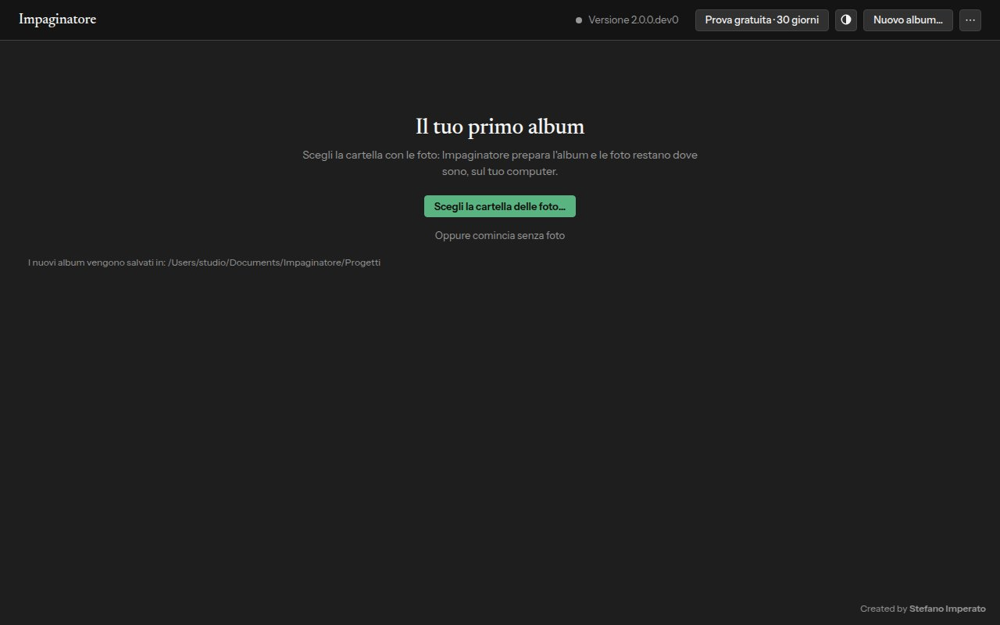
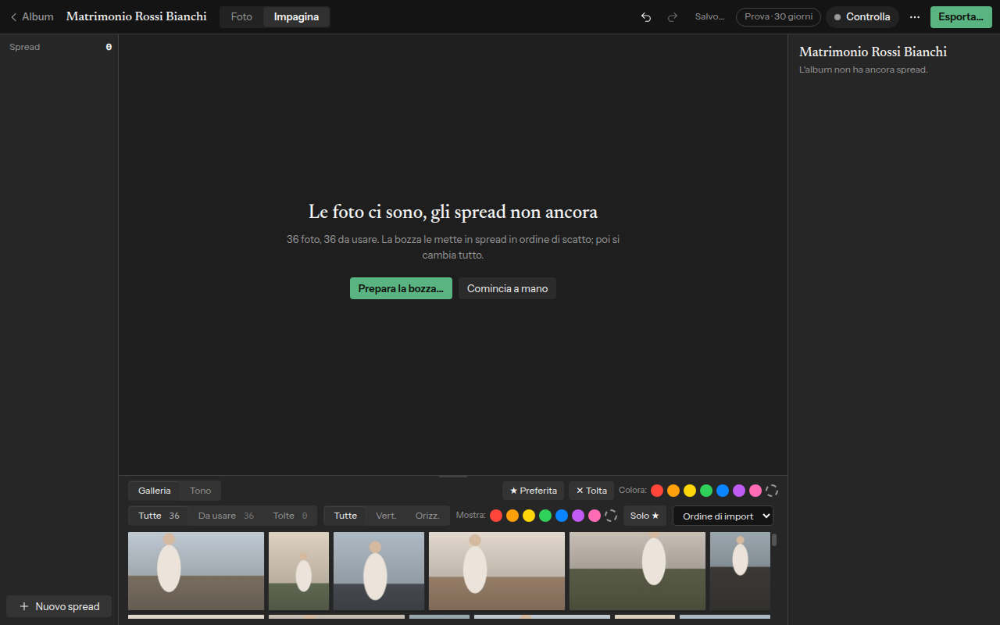

# 1. Il primo album in dieci minuti

Ti serve una cartella con le foto scelte del servizio. Bastano 10 foto per provare la bozza automatica.

## Crea l'album

1. Apri Impaginatore. Si apre la schermata **Album**.
2. Premi «Scegli la cartella delle foto…».
3. Scegli la cartella con le foto e conferma.
4. Si apre la finestra «Nuovo album». Il nome è già quello della cartella. Se vuoi, cambialo.
5. In «Dimensioni dell'album aperto (due pagine), in cm» premi un formato pronto, per esempio «60 × 22,5».
   Oppure scrivi larghezza e altezza. Sotto leggi la misura di ogni pagina.
6. Premi «Crea». L'album si apre.

L'album nasce accanto alla cartella delle foto, in una cartella chiamata `Impaginatore`. Le foto restano dove sono:
l'album le legge da lì.

## Prepara la bozza

All'apertura l'album non ha spread. Al centro leggi «Le foto ci sono, gli spread non ancora».

1. Premi «Prepara la bozza…».
2. Guarda la proposta. Gli spread sono in ordine di scatto.
3. Se non ti piace, premi «Un'altra proposta».
4. Premi «Aggiungi N spread» (N è il numero degli spread proposti).

Gli spread entrano nell'album. A sinistra vedi l'elenco degli spread.

## Sistema quello che non ti piace

1. Clicca uno spread nell'elenco a sinistra.
2. Premi D per vedere un'altra disposizione delle stesse foto. Premi D ancora per la successiva.
3. Premi Esc per tornare alla disposizione di prima.
4. Per cambiare una foto, clicca la foto e premi S. Scegli la nuova foto.

Ogni modifica si annulla con Ctrl+Z.

## Controlla l'album

1. Premi «Controlla» in alto, oppure C.
2. Leggi l'esito. «Pronto per la stampa» vuol dire che non c'è niente da sistemare.
3. Se c'è un numero su «Sistema», premilo: il programma corregge spazi e tono da solo.
4. Le altre righe vanno guardate a mano. Clicca una riga per andare allo spread.

## Esporta

1. Premi «Esporta…» in alto a destra.
2. Scegli «JPG» per il laboratorio o «PDF» per mandare la bozza al cliente.
3. Premi «Esporta in JPG» (o «Esporta in PDF»).
4. Alla fine compare «Esportazione finita». Premi «Mostra nel Finder» per aprire la cartella. Su Windows il pulsante
   si chiama «Mostra in Esplora risorse», su Linux «Mostra nel gestore file».

I file finiscono nella cartella `Esportazioni` dentro l'album. Durante la prova gratuita hanno la filigrana.

Non devi salvare: il programma salva da solo mentre lavori. Per tornare all'elenco degli album premi «‹ Album».
