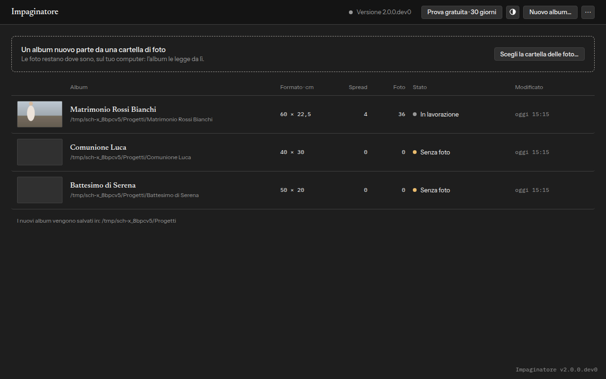
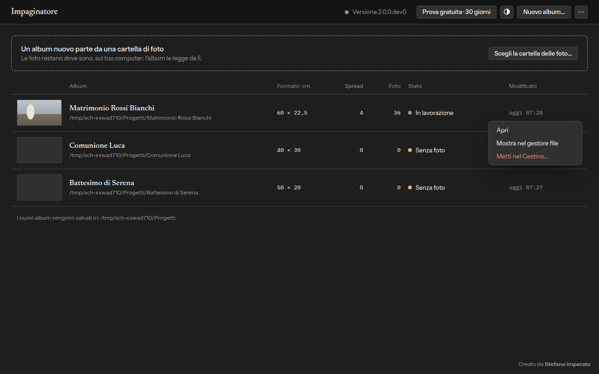
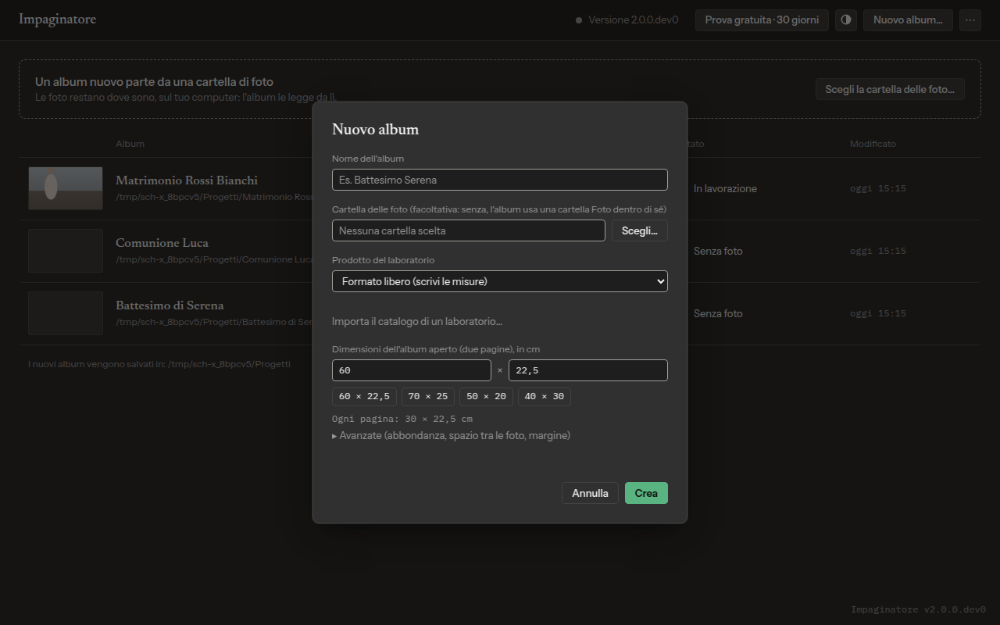

# 2. La schermata Album

È la prima schermata del programma. Elenca i tuoi album e serve a crearne di nuovi.

## La barra in alto

Da sinistra a destra:

- **Versione** (per esempio «Versione 2.0.0.dev0»). Apre «Versione del programma».
- **Licenza**. Il pulsante dice lo stato: «Prova gratuita · 30 giorni», «Licenza Pro», «Sola lettura · inserisci la
  licenza». Apre la finestra «Licenza». Vedi [Prova gratuita e licenza](11-prova-licenza.md).
- **◐** passa dal tema scuro al tema chiaro e viceversa.
- «Nuovo album…» apre la finestra per creare un album.
- «⋯» apre altri comandi:
  - «Apri album esistente…»: aggiunge all'elenco un album che sta in un'altra cartella;
  - «Importa ZIP…»: apre un album ricevuto come file ZIP;
  - «Assistente AI…»: impostazioni dell'assistente (vedi la [guida all'assistente](assistente/INDICE.md));
  - «Chiudi programma».

## L'elenco degli album

Ogni riga è un album. Le colonne:

| Colonna | Cosa dice |
|---|---|
| Album | nome e cartella dell'album |
| Formato · cm | misura dell'album aperto, per esempio 60 × 22,5 |
| Spread | quanti spread ha |
| Foto | quante foto ha |
| Stato | «In lavorazione», «Senza foto», «Aperto» (è aperto adesso), «Non si apre» (vedi [Domande frequenti](13-domande.md)) |
| Modificato | l'ultima modifica |

Con più di 12 album compare il campo «Cerca un album»: scrivi una parte del nome.

### Aprire un album

- Doppio clic sulla riga.
- Oppure passa sopra la riga con il mouse e premi «Apri».
- Oppure con la tastiera: frecce su e giù per scegliere, Invio per aprire.

### Altri comandi di un album

Passa sopra la riga e premi «⋯»:

- «Apri».
- «Mostra nel Finder» apre la cartella dell'album. Su Windows si chiama «Mostra in Esplora risorse», su Linux «Mostra
  nel gestore file».
- «Metti nel Cestino…» per gli album nella cartella degli album. Chiede conferma: «Mettere «nome» nel Cestino?».
  L'album va nel Cestino con le foto che ha nella sua cartella. Le foto che stanno in altre cartelle restano dove sono.
  Dal Cestino lo puoi recuperare.
- «Togli dall'elenco» per gli album che stanno in altre cartelle. L'album non si cancella: sparisce solo dall'elenco.

## Creare un album

Ci sono due modi.

**Dalla cartella delle foto** (il più semplice):

1. Premi «Scegli la cartella delle foto…» nel riquadro in alto.
2. Scegli la cartella. Si apre «Nuovo album» con il nome della cartella.

L'album nasce accanto alle foto, in una cartella `Impaginatore`. Se c'è già, il programma usa `Impaginatore 2`.

**Senza foto**:

1. Premi «Nuovo album…».
2. Lascia vuota «Cartella delle foto». L'album usa una cartella `Foto` dentro di sé. Le foto le aggiungi dopo.

L'album nasce nella cartella scritta in fondo alla schermata: «I nuovi album vengono salvati in: …».

### La finestra «Nuovo album»

1. **Nome dell'album.** Per esempio «Battesimo Serena».
2. **Cartella delle foto (facoltativa).** «Scegli…» per sceglierla.
3. **Dimensioni dell'album aperto (due pagine), in cm.** Premi un formato pronto (60 × 22,5, 70 × 25, 50 × 20,
   40 × 30) o scrivi larghezza e altezza. La riga «Ogni pagina: …» dice la misura di una pagina.
4. «▸ Avanzate (abbondanza, spazio tra le foto, margine)» apre tre misure in millimetri:
   - «Abbondanza (mm)»: quanto la stampa va oltre il bordo da tagliare. Di serie 0. Chiedila al tuo laboratorio.
   - «Spazio tra le foto (mm)»: di serie 2,5.
   - «Margine (mm)»: di serie 10.
5. Premi «Crea». L'album si crea e si apre.

Le misure valide vanno da 5 a 300 cm in larghezza e da 5 a 200 cm in altezza.

## Quando la prova sta per finire

Negli ultimi 7 giorni della prova gratuita, in fondo alla schermata compare «Prova: restano N giorni» con il pulsante
«Licenza…».

## Versione e aggiornamenti

Il pulsante della versione apre «Versione del programma». «Controlla aggiornamenti» funziona solo nelle copie del
programma prese dal codice sorgente. Nelle altre leggi «Gli aggiornamenti automatici non sono disponibili.»
Gli aggiornamenti per chi compra il programma non ci sono ancora.

## Chiudere il programma

Premi «⋯» › «Chiudi programma» › «Chiudi il programma». Le modifiche sono già salvate.
