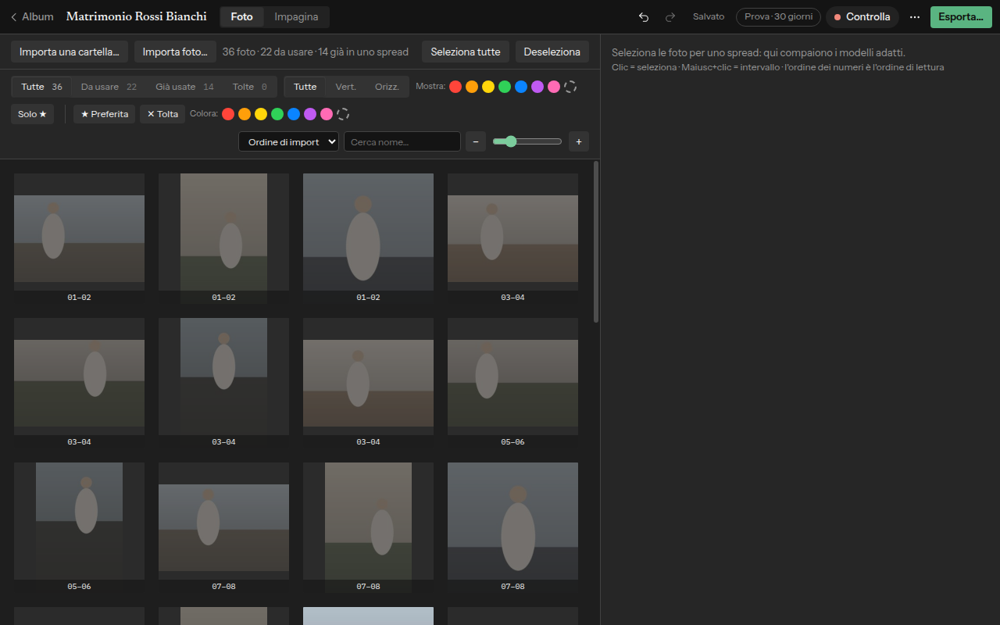

# 3. Le foto: importare e scegliere

L'album lavora con le foto che gli dai. Non le copia e non le modifica: le legge dalla loro cartella.

## Quali foto

Il programma apre foto JPG, PNG, TIFF e WebP. Le foto HEIC dell'iPhone si aprono solo se il programma è installato
con il componente per HEIC; altrimenti convertile in JPG. I file RAW non si aprono: esporta prima i JPG dal tuo
programma di sviluppo.

Le foto con un profilo colore diverso da sRGB (per esempio Adobe RGB) vengono convertite in sRGB.

## La vista Foto

In alto ci sono due linguette: «Foto» e «Impagina». Passi dall'una all'altra con Ctrl+1 e Ctrl+2.

La vista Foto mostra tutte le foto dell'album. Sotto ogni foto c'è lo spread dove è usata, per esempio «03–04».

## Aggiungere foto

1. Vai in «Foto».
2. Premi «Importa una cartella…» per una cartella intera (con le sottocartelle). Premi «Importa foto…» per scegliere
   le singole foto.
3. Si apre una finestra con le cartelle. Se la cartella che cerchi non c'è, premi «Altra cartella…» e sceglila.
4. Premi «Importa questa cartella», oppure seleziona le foto e premi «Importa N foto».

Le foto compaiono subito, senza riaprire l'album. Un avviso dice quante ne sono state aggiunte e quante saltate.

Una foto viene saltata se:

- nell'album c'è già una foto con lo stesso nome di file (anche da un'altra cartella);
- il formato non è tra quelli sopra.

> Se usi due macchine fotografiche, i nomi dei file possono ripetersi (`IMG_0001.jpg`). Rinomina le foto prima di
> importarle, altrimenti quelle con il nome già presente restano fuori.

## Scegliere le foto da usare

Ogni foto è in uno di questi gruppi. I filtri in alto li mostrano:

- «Tutte»;
- «Da usare»: non sono ancora in uno spread e non le hai tolte;
- «Già usate» (nella vista Foto): sono in uno spread;
- «Tolte»: le hai scartate, non vanno nell'album.

Clicca una foto per selezionarla. Maiusc+clic seleziona un intervallo. «Seleziona tutte» e «Deseleziona» fanno quello
che dicono.

Con le foto selezionate:

- «★ Preferita» (tasto P) la segna come preferita. La bozza dà più spazio alle preferite.
- «✕ Tolta» (tasto X) la toglie dalle foto da usare. Premi di nuovo per rimetterla.
- «Colora:» dà un'etichetta colore (tasti da 1 a 7; 0 la toglie).

Altri filtri:

- «Tutte», «Vert.», «Orizz.»: per orientamento;
- «Mostra:» e un colore: solo le foto con quell'etichetta;
- «Solo ★»: solo le preferite;
- l'elenco «Ordine di import» cambia l'ordine: per nome, per data di scatto, per colore;
- «Cerca nome…» cerca per nome di file.

Z apre l'anteprima grande della foto. Con ← e → passi alla foto prima e dopo.

## Fare uno spread dalle foto

1. In «Foto», seleziona le foto che vuoi sullo stesso spread. L'ordine dei clic è l'ordine di lettura.
2. A destra compaiono i modelli adatti a quelle foto.
3. In «Aggiungi lo spread» scegli «in fondo» o «dopo quello aperto».
4. Clicca il modello che ti piace. Lo spread si aggiunge all'album.

## La galleria sotto lo spread

Nella vista «Impagina», sotto lo spread c'è la «Galleria» con le stesse foto e gli stessi filtri.

- Trascina una foto su una foto dello spread: la sostituisce.
- Trascina una foto su uno spazio vuoto dello spread: la aggiunge come foto libera.
- Trascina una foto nell'elenco degli spread a sinistra: tra due spread ne crea uno nuovo; sopra uno spread la
  aggiunge a quello spread. Il programma chiede se riorganizzare lo spread con un altro modello o lasciarlo così.

La linguetta «Galleria» si chiude e si riapre con un clic. Accanto c'è «Tono»: vedi [Il tono delle foto](07-tono.md).
