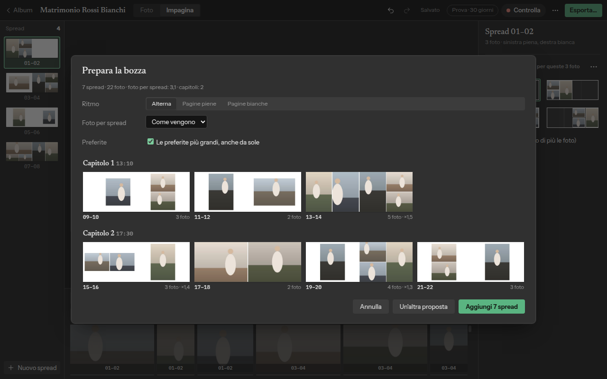

# 4. Prepara la bozza

«Prepara la bozza» mette in spread tutte le foto da usare, in ordine di scatto. Tu poi cambi quello che vuoi.

## Prima di cominciare

- Servono almeno 10 foto da usare. Con meno il programma dice «Servono almeno 10 foto».
- La bozza usa solo le foto «Da usare»: quelle non ancora negli spread e non tolte. Togli prima le foto che non vuoi
  (vedi [Le foto](03-foto.md)).
- Segna come preferite (★) le foto più belle: la bozza le fa più grandi.
- La bozza c'è nelle licenze Pro e Studio e nella prova gratuita. Non c'è nella licenza Essenziale.

## Come si fa

1. Apri la bozza in uno di questi modi:
   - in un album senza spread, premi «Prepara la bozza…» al centro;
   - premi «+ Nuovo spread» in basso a sinistra › «Prepara la bozza…»;
   - premi «⋯» in alto › «Prepara la bozza…».
2. Scegli il «Ritmo»:
   - «Alterna»: uno spread con le due pagine piene, il successivo con una pagina con il margine bianco;
   - «Pagine piene»: le foto arrivano al bordo della pagina;
   - «Pagine bianche»: margine bianco intorno alle foto.
3. Scegli «Foto per spread». «Come vengono» lascia decidere al programma. Da 1 a 8 fissa il numero.
4. Lascia acceso «Le preferite più grandi, anche da sole» se vuoi le preferite in evidenza.
5. Guarda la proposta. In alto leggi quanti spread, quante foto e quanti capitoli.
6. Premi «Un'altra proposta» per vederne una diversa.
7. Premi «Aggiungi N spread». Gli spread vanno in fondo all'album.

«Annulla» chiude la finestra senza cambiare niente.

## Cosa fa la bozza

- **Ordine di scatto.** Le foto seguono la data di scatto scritta nella foto.
- **Capitoli.** Se tra due scatti passano più di 30 minuti, comincia un capitolo nuovo (per esempio dalla chiesa al
  ricevimento). Un capitolo comincia su uno spread nuovo.
- **Panoramiche e preferite.** Una foto molto larga (almeno 1,8 volte più larga che alta) apre uno spread e sta da
  sola su una pagina. Sull'altra pagina vanno le foto che seguono. Lo stesso vale per le preferite, se è acceso «Le
  preferite più grandi, anche da sole».
- **Ritagli.** La bozza evita di tagliare troppo le foto. Sotto ogni spread, «×1,4» vuol dire che la foto più tagliata
  è ingrandita 1,4 volte nella cornice.

Gli spread che ci sono già non si toccano.

## Dopo la bozza

La bozza è un punto di partenza. Per cambiarla:

- D cambia la disposizione dello spread (vedi [Impaginare](05-impaginare.md));
- S sostituisce una foto;
- trascina uno spread nell'elenco a sinistra per spostarlo;
- Ctrl+Z annulla tutta la bozza in un passo.
