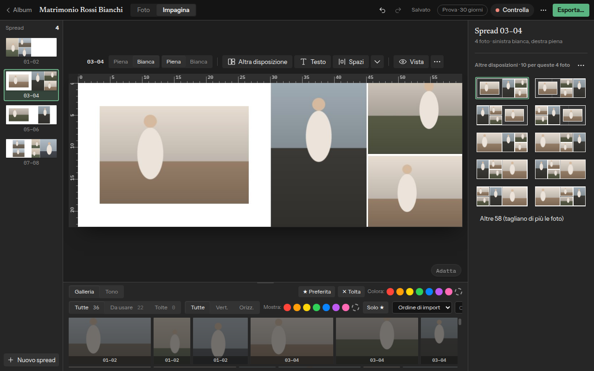
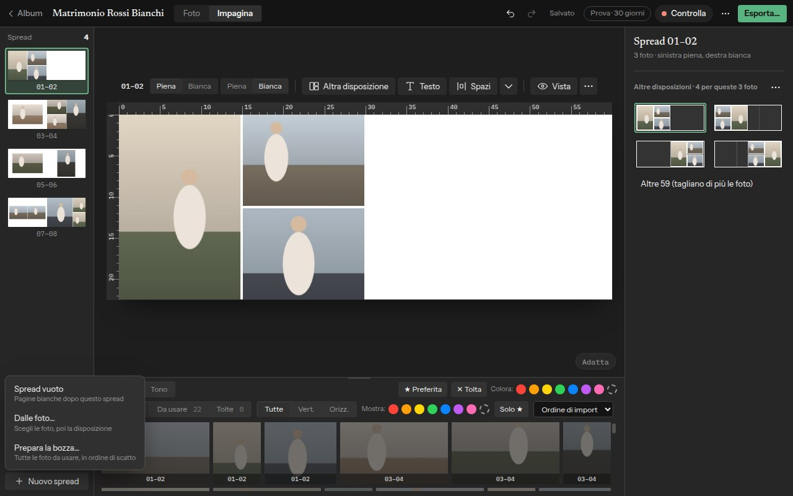
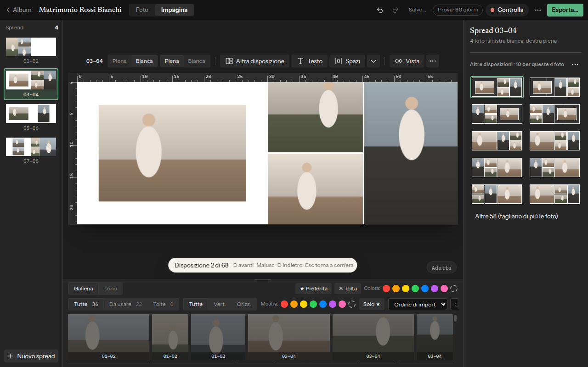
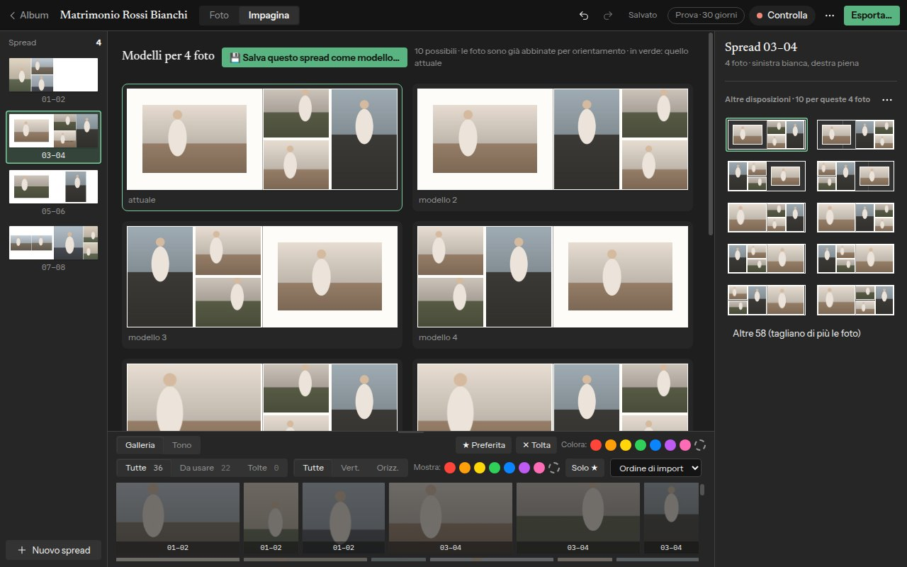
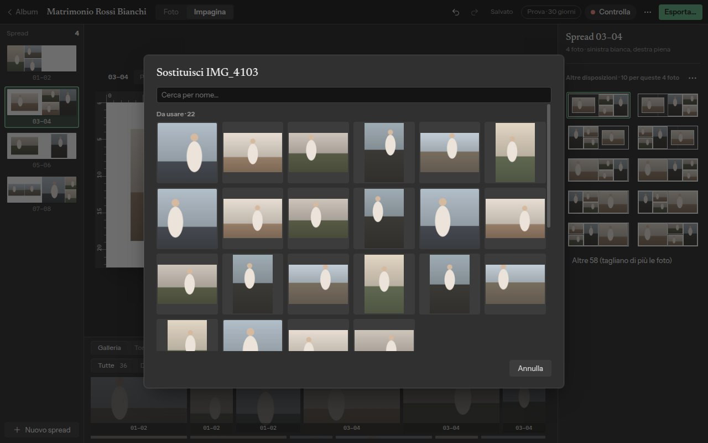
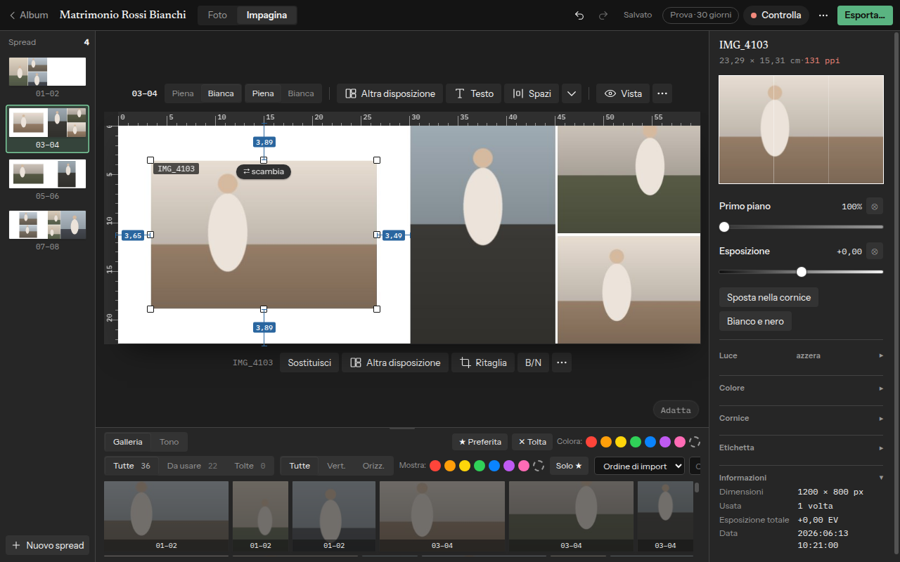
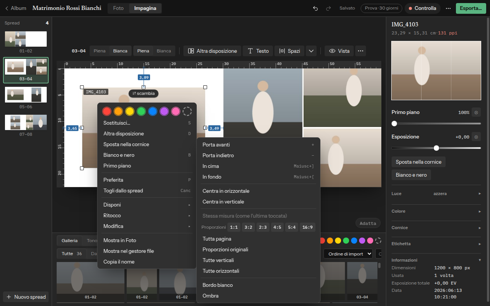
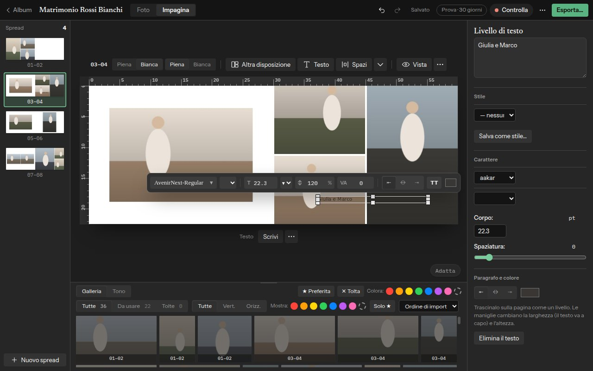
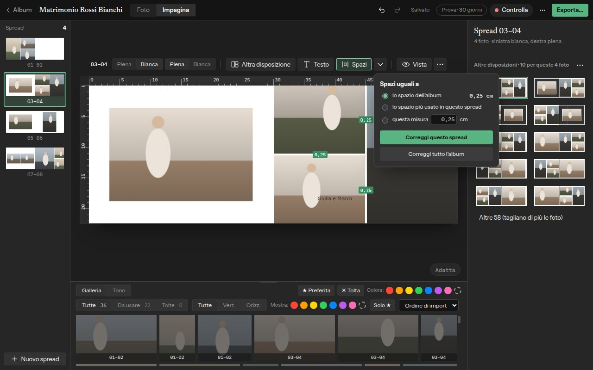

# 5. Impaginare: disposizioni, foto, testi, spazi

## L'editor a colpo d'occhio

- **In alto:** «‹ Album» torna all'elenco degli album. Poi il nome dell'album, le linguette «Foto» e «Impagina»,
  annulla e ripeti, lo stato del salvataggio, la licenza, «Controlla», «⋯» e «Esporta…».
- **A sinistra:** l'elenco degli spread. In fondo, «+ Nuovo spread».
- **Al centro:** lo spread aperto. Sopra c'è la barra dello spread.
- **A destra:** il pannello. Mostra le disposizioni dello spread, o le regolazioni della foto selezionata.
- **In basso:** la «Galleria» delle foto (vedi [Le foto](03-foto.md)).

F nasconde i pannelli e lascia solo lo spread («Tela piena»). Premi F di nuovo per tornare.

Con la finestra stretta (meno di 1280 pixel di larghezza) l'elenco degli spread mostra solo i numeri e il pannello di
destra resta chiuso. Lo apri con «Pannello», in fondo alla barra dello spread: si apre sopra lo spread, che non si
rimpicciolisce. Esc lo chiude.

## Gli spread

- Clicca uno spread nell'elenco per aprirlo. ↑ e ↓ passano allo spread prima e dopo.
- Trascina uno spread nell'elenco per cambiargli posto.
- Clic destro su uno spread (o «⋯» nella barra dello spread) apre altri comandi: «Nuovo spread vuoto dopo»,
  «Duplica», «Sposta prima», «Sposta dopo», «Inverti le pagine», «Esporta come JPG…», «Elimina lo spread».
- «+ Nuovo spread» offre «Spread vuoto», «Dalle foto…» e «Prepara la bozza…».

## La barra dello spread

Sopra lo spread trovi:

- il numero dello spread, per esempio «03–04»;
- per ogni pagina, **Piena** o **Bianca**. «Piena»: le foto arrivano al bordo della pagina. «Bianca»: c'è un margine
  bianco intorno alle foto;
- «Altra disposizione» (D);
- «Testo» (T);
- «Spazi» e la freccia accanto;
- «Vista»: «Magnete», «Righelli», «Guide», «Blocca le guide», «Avviso di ritaglio», «Cancella le guide»;
- «⋯»: gli stessi comandi del clic destro sullo spread.

## Cambiare la disposizione

La disposizione è come stanno le foto sullo spread: quante per pagina, grandi o piccole, dove.

1. Apri lo spread.
2. Premi D. Le stesse foto si mettono in un'altra disposizione.
3. Premi D ancora per la successiva. Maiusc+D torna alla precedente.
4. Esc torna alla disposizione che c'era prima di cominciare.

Mentre scorri, in basso leggi «Disposizione 2 di 68 · D avanti · Maiusc+D indietro · Esc torna a com'era».

Se hai spostato le foto a mano, D le rimette in una disposizione pronta. Esc ti riporta a com'erano.

Con una foto selezionata, D cambia solo la pagina di quella foto.

### Le disposizioni nel pannello

Senza niente selezionato, il pannello a destra mostra «Altre disposizioni · N per queste K foto». Clicca una
miniatura per usarla. «Altre N (tagliano di più le foto)» mostra quelle che tagliano di più.

### I modelli

M apre i modelli: tutte le disposizioni per il numero di foto dello spread, grandi. Clicca un modello per usarlo.

Per salvare lo spread come modello tuo, premi «Salva questo spread come modello…». La licenza Essenziale tiene al
massimo 5 modelli tuoi.

## Sostituire una foto

1. Clicca la foto sullo spread.
2. Premi S, oppure «Sostituisci» sotto lo spread.
3. Si apre «Sostituisci nome-della-foto». In alto ci sono le foto «Da usare», sotto quelle «Già nell'album».
   Puoi cercare per nome.
4. Clicca la foto nuova.

Cosa succede:

- La foto nuova prende il posto della vecchia. La vecchia torna tra quelle da usare.
- Se la foto nuova è già in un altro spread, le due foto si scambiano. Leggi «Scambiata con lo spread N».
- Se nella cornice la foto nuova verrebbe tagliata troppo (per esempio una verticale al posto di un'orizzontale), il
  programma adatta la disposizione e leggi «Disposizione adattata alla nuova foto». Se preferisci la cornice di prima,
  premi «Tieni la cornice di prima».

Puoi anche trascinare una foto dalla Galleria sopra quella da cambiare.

### Scambiare due foto

Seleziona una foto. Sopra compare «⇄ scambia». Trascinalo sopra un'altra foto dello spread: le due foto si scambiano.

## Lavorare su una foto

Clicca una foto. Intorno compaiono le maniglie e le distanze in cm dai bordi e dalle altre foto.

- **Spostare:** trascina la foto. Il magnete la aggancia alle guide e alle altre foto. Tieni Alt per staccarla.
- **Ridimensionare:** trascina una maniglia. Tieni Maiusc per mantenere le proporzioni.
- **Spostare di poco:** frecce (0,01 cm), Maiusc+frecce (0,1 cm).
- **Spostare la foto dentro la cornice:** doppio clic sulla foto, oppure «Ritaglia». Trascina la foto.
- **Bianco e nero:** «B/N» o B.
- **Togliere la foto dallo spread:** Canc. La foto torna tra quelle da usare.
- **Più foto insieme:** Maiusc+clic. Compaiono «Stessa misura» e «Allinea».

Il pannello a destra mostra il nome della foto, la misura in cm e la risoluzione in ppi:

- verde da 200 ppi in su: va bene per la stampa;
- ocra tra 150 e 200 ppi: da guardare;
- rosso sotto 150 ppi: la foto è troppo ingrandita, in stampa si vede.

Poi ci sono «Primo piano» (ingrandisce la foto nella cornice), «Esposizione», «Sposta nella cornice», «Bianco e nero»,
e le sezioni «Luce», «Colore», «Cornice» (angolo, opacità, bordo, ombra), «Etichetta», «Informazioni» (misura in
pixel, quante volte è usata, dati di scatto).

Il clic destro su una foto apre tutti i comandi, con i tasti accanto.

## Scrivere un testo

1. Premi «Testo» nella barra dello spread, oppure T.
2. Clicca sulla pagina dove vuoi il testo. Oppure trascina per disegnare il riquadro.
3. Scrivi il testo nel pannello a destra, nel riquadro «Livello di testo».
4. Scegli «Carattere», «Corpo» (in punti), «Spaziatura», allineamento e colore.
5. Per riusare lo stesso aspetto, premi «Salva come stile…» e poi scegli lo stile dall'elenco «Stile».
6. Per cancellarlo, premi «Elimina il testo».

Puoi anche fare clic destro sulla pagina › «Aggiungi testo qui».

I caratteri sono quelli installati sul tuo computer. Se porti l'album su un altro computer, installa anche lì gli
stessi caratteri: la copia del progetto ne contiene l'elenco nel file `font_usati.txt`.

Nei PSD il testo resta un livello di testo modificabile in Photoshop.

## Spazi uguali tra le foto

Lo spazio tra le foto è uguale in tutto l'album, di serie 2,5 mm. Dopo modifiche a mano può cambiare.

1. Premi «Spazi» nella barra dello spread. Su ogni spazio compare la misura in cm.
2. Premi la freccia accanto a «Spazi». Si apre «Spazi uguali a».
3. Scegli la misura:
   - «lo spazio dell'album»;
   - «lo spazio più usato in questo spread»;
   - «questa misura» e scrivi i cm.
4. Premi «Correggi questo spread» o «Correggi tutto l'album».

Le foto libere o sovrapposte non si correggono da sole: il programma lo dice e le guardi tu.

«Correggi tutto l'album» c'è nelle licenze Pro e Studio e nella prova. Con Essenziale correggi uno spread alla volta.

## Righelli e guide

- R mostra o nasconde i righelli. Le misure sono in cm.
- Trascina dal righello per creare una guida. G mostra o nasconde le guide.
- In «Vista»: «Blocca le guide», «Cancella le guide», «Magnete».
- «Avviso di ritaglio» segna le foto ingrandite più di 1,25 volte nella cornice.

## Annullare

Ctrl+Z annulla. Ctrl+Maiusc+Z (o Ctrl+Y) ripete. Un avviso dice cosa hai annullato, per esempio «Annullato: Elimina
spread».
