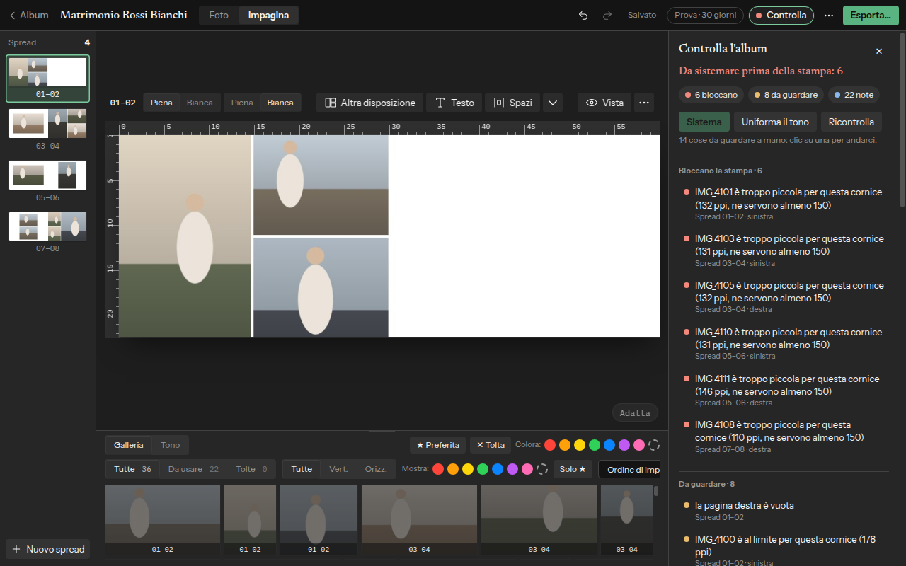

# 6. Controlla e Sistema

Prima di mandare l'album in stampa, fallo controllare. Il programma cerca quello che si vede male in stampa.

## Aprire il controllo

Premi «Controlla» in alto, oppure C. Si apre «Controlla l'album».

Il pallino accanto a «Controlla» dice lo stato anche a pannello chiuso:

- verde: «Pronto per la stampa»;
- ocra: ci sono cose da guardare;
- rosso: ci sono cose che bloccano la stampa.

## Cosa leggi

In alto c'è l'esito:

- «Pronto per la stampa»: niente da sistemare;
- «Si può stampare; N cose da guardare»: la stampa viene, ma alcune cose vanno viste;
- «Da sistemare prima della stampa: N»: qualcosa si vede male in stampa.

Sotto ci sono tre gruppi.

**«Bloccano la stampa»**

- una foto non si trova più (vedi [Foto da ricollegare](10-progetti-e-foto.md));
- una foto è danneggiata;
- una foto è troppo piccola per la sua cornice: meno di 150 ppi;
- una foto o un testo esce dalla pagina e si taglia in stampa.

**«Da guardare»**

- una foto è al limite: tra 150 e 200 ppi;
- una foto è tagliata molto per stare nella cornice (più di 1,25 volte);
- un volto è tagliato dal ritaglio, o è vicino alla piega centrale;
- gli spazi tra le foto non sono uguali;
- una pagina è vuota;
- una foto è più chiara o più scura del resto dell'album;
- una foto è usata in due spread.

**«Note»**

- foto non usate nell'album, con le preferite in evidenza.

Clicca una riga per andare allo spread e alla foto.

## Sistema

«Sistema (N)» corregge da solo due cose:

- gli spazi diversi tra le foto;
- le foto fuori tono rispetto all'album.

1. Premi «Sistema (N)».
2. Leggi l'avviso, per esempio «Sistemati: spazi in 3 spread, tono di 5 foto».
3. Se non ti piace, premi «Annulla» nell'avviso, o Ctrl+Z. Si annulla tutto in un passo.

Il resto va guardato a mano: il programma te lo dice con «N cose da guardare a mano: clic su una per andarci».

Altri pulsanti:

- «Uniforma il tono»: corregge solo il tono.
- «Ricontrolla»: rifà il controllo.

## Con la licenza Essenziale

- «Sistema» corregge solo lo spread aperto. Leggi «Qui Sistema corregge lo spread aperto.»
- «Uniforma il tono» non fa parte della licenza: il pulsante lo dice.

Il controllo vero e proprio è uguale per tutte le licenze.
