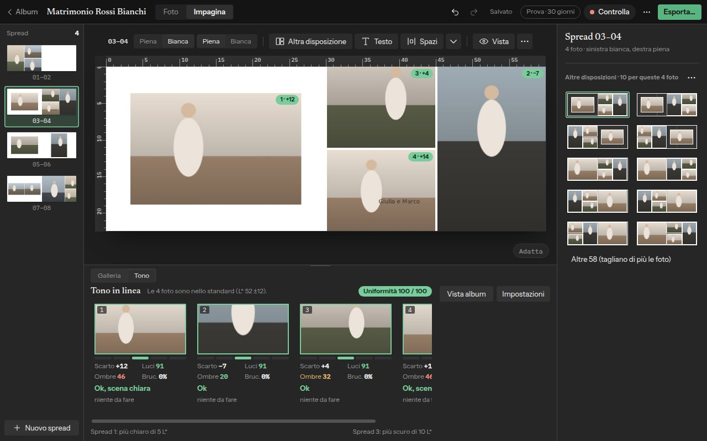

# 7. Il tono delle foto

Su uno spread, una foto più chiara o più scura delle altre salta all'occhio. La linguetta «Tono» misura la luce delle
foto e ti dice quali escono dallo standard dell'album.

## Aprire «Tono»

1. Vai in «Impagina».
2. Sotto lo spread, accanto a «Galleria», premi «Tono».

## Cosa leggi

In alto, per lo spread aperto:

- «Tono in linea» se tutte le foto sono nello standard, altrimenti quante foto sono da sistemare;
- «Uniformità N / 100»: 100 vuol dire che le foto dello spread hanno la stessa luce.

Per ogni foto:

- **Scarto**: di quanto la luce media della foto si discosta dallo standard dell'album. Per esempio +12 vuol dire più
  chiara;
- **Luci** e **Ombre**: quanto sono chiare le zone più chiare e quanto sono scure le zone più scure;
- **Bruc.**: la parte della foto bruciata, cioè bianca senza dettaglio;
- in fondo, l'esito: per esempio «Ok» e «niente da fare», oppure cosa c'è da sistemare.

Sullo spread ogni foto mostra un numero e il suo scarto, per esempio «1 · +12».

In fondo leggi gli spread vicini più chiari o più scuri, per esempio «Spread 3: più scuro di 10 L*».

Le misure usano L*, la luminosità percepita: 0 è nero, 100 è bianco, 50 è il grigio medio.

## Altri comandi

- «Vista album» mostra il tono di tutti gli spread insieme. «Torna allo spread» torna allo spread.
- «Impostazioni»: i numeri sulle foto e lo «Standard L*», cioè la luce media giusta e quanto ci si può scostare.
  Per ritratti e bambini il programma suggerisce da 52 a 58.
- Clic destro su una foto la esclude dalla misura (per esempio una foto scura voluta). Clic destro di nuovo per
  rimetterla.

## Correggere il tono

La linguetta misura e basta. Per correggere:

- **Tutto l'album:** «Controlla» › «Uniforma il tono», oppure «Sistema» (vedi [Controlla e Sistema](06-controlla.md)).
- **Una foto:** selezionala e sposta «Esposizione» nel pannello a destra.

La correzione cambia solo come la foto appare nell'album e nei file esportati. L'originale non cambia.

«Uniforma il tono» c'è nelle licenze Pro e Studio e nella prova gratuita.
