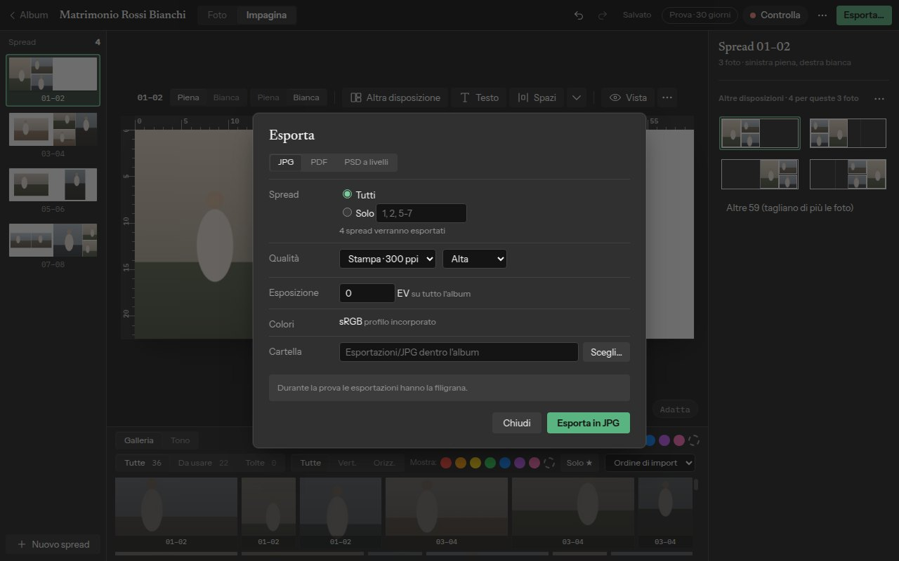

# 8. Esportare: JPG, PDF, PSD

## Quale formato

| Formato | Per chi | Cosa ottieni |
|---|---|---|
| JPG | il laboratorio | un file per spread, a 300 ppi, con l'abbondanza |
| PDF | il cliente | un solo file leggero da mandare per l'approvazione. Non è un file per la stampa |
| PSD a livelli | te, in Photoshop | un file per spread, ogni foto e ogni testo su un livello |

## Esportare

1. Premi «Esporta…» in alto a destra, oppure Ctrl+E.
2. Scegli «JPG», «PDF» o «PSD a livelli».
3. In «Spread» lascia «Tutti», oppure scegli «Solo» e scrivi quali, per esempio «1, 2, 5-7».
4. Scegli la «Qualità» (sotto).
5. Controlla la «Cartella». Per cambiarla premi «Scegli…».
6. Premi «Esporta in JPG» (o «Esporta in PDF», «Esporta in PSD»).

In «Solo» i numeri sono quelli degli spread, non delle pagine: lo spread 1 è «01–02», lo spread 3 è «05–06».

Mentre esporta, il pulsante in alto dice «Esporto JPG…». Non chiudere la finestra del programma finché non finisce.
Alla fine compare «Esportazione finita» con il pulsante per aprire la cartella.

Per esportare un solo spread: clic destro sullo spread nell'elenco › «Esporta come JPG…».

## Le opzioni

**JPG**

- «Stampa · 300 ppi»: il file per il laboratorio. Usa le foto originali e contiene l'abbondanza.
- «Schermo»: un file piccolo, a un quarto della risoluzione, senza abbondanza. Per vedere l'album sullo schermo.
- Compressione: «Massima», «Alta» (di serie), «Media». Più alta, file più grandi e migliori.

**PDF**

- «Leggero (da mandare)», «Medio», «Alto»: dimensione delle pagine. «Leggero» va bene per l'email.
- «Numero dello spread sulla pagina»: sotto ogni spread scrive «Spread 3 / 20».

**PSD a livelli**

- «Serve Photoshop su questo computer.» Il programma apre Photoshop e crea i file. Photoshop resta occupato fino alla
  fine.
- I PSD che hai modificato a mano non vengono toccati. Per rifarli, spunta «Rifai anche i PSD modificati a mano».
- Prima di cominciare il programma chiede conferma: premi «Genera i PSD».
- Su Linux i PSD non si possono creare.

**Per tutti i formati**

- «Esposizione … EV su tutto l'album» schiarisce (numeri positivi) o scurisce (negativi) tutto l'album. Cambia anche
  l'album nell'editor, non solo i file. Si annulla con Ctrl+Z.
- «Colori»: sRGB, con il profilo dentro il file.

## Dove finiscono i file

Di serie, dentro la cartella dell'album:

- JPG in `Esportazioni/JPG`, con nomi come `Matrimonio Rossi - Spread 01.jpg`;
- PDF in `Esportazioni/PDF`, con il nome `Matrimonio Rossi - bozza.pdf`;
- PSD nella cartella `PSD` dell'album.

Se esporti di nuovo nella stessa cartella, i file con lo stesso nome vengono sostituiti.

## Durante la prova gratuita

- JPG e PDF hanno la filigrana. Lo dice anche la finestra: «Durante la prova le esportazioni hanno la filigrana.»
- I PSD non ci sono.

Con la licenza Essenziale JPG e PDF sono senza filigrana; i PSD ci sono solo con Pro e Studio.

## Se qualcosa non va

- **«N foto di questi spread non si trovano più…»**: l'esportazione non parte. Ricollega le foto (vedi
  [Foto da ricollegare](10-progetti-e-foto.md)) e riprova.
- **«N foto di questi spread sono danneggiate o incomplete…»**: ricopia quelle foto nella loro cartella.
- **«Non posso scrivere in …»**: la cartella è protetta o il disco è pieno. Scegli un'altra cartella.
- **«N spread non esportati: …»**: gli altri spread sono stati esportati. Il motivo è nella finestra «Esporta».
