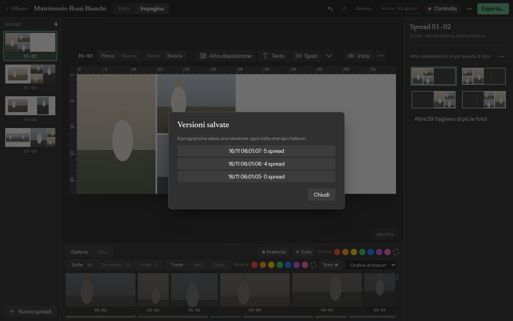

# 9. Salvataggi e versioni

## Il programma salva da solo

Non serve salvare. Due secondi dopo l'ultima modifica il programma salva l'album.

In alto, accanto ad annulla e ripeti, leggi lo stato:

- «Salvo…»: sta salvando;
- «Salvato» o «Salvato alle 15:42»: tutto è sul disco;
- «Non salvato: riprova»: il salvataggio non è riuscito. Cliccalo per riprovare. Se succede ancora, guarda che il
  disco non sia pieno o scollegato.

Ctrl+S salva subito e tiene una copia della versione di prima.

## Le versioni salvate

Il programma tiene copie dell'album com'era prima. Ti servono se vuoi tornare indietro di ore, non di qualche passo
(per qualche passo basta Ctrl+Z).

Una copia si fa:

- la prima volta che l'album cambia dopo averlo aperto: è l'album com'era all'apertura;
- poi al massimo ogni 10 minuti mentre lavori;
- ogni volta che premi Ctrl+S;
- prima di tornare a una versione vecchia.

Il programma tiene le ultime 200 copie, nella cartella `_backup_editor` dell'album.

## Tornare a una versione

1. Premi «⋯» in alto › «Versioni salvate…».
2. Ogni riga dice data, ora e quanti spread, per esempio «16/11 05:59:07 · 5 spread».
3. Clicca la versione che vuoi.
4. Il programma chiede «Tornare alla versione del …?». Premi «Torna a questa».

Lo stato di adesso viene salvato prima, come versione: se cambi idea, ci torni dalla stessa lista. L'editor si ricarica
con la versione scelta.

Anche in sola lettura (prova finita) puoi tornare a una versione.

## Dove sono i file

Tutto l'album sta nella sua cartella:

| File o cartella | Cosa contiene |
|---|---|
| `progetto.json` | nome, misure, cartella delle foto, correzioni |
| `album.json` | gli spread |
| `Foto` | le foto, se l'album non usa un'altra cartella |
| `_backup_editor` | le versioni salvate |
| `_cache` | miniature, volti riconosciuti e dati delle foto |
| `Esportazioni`, `PSD` | i file esportati |

Non modificare questi file a mano. Per spostare un album su un altro computer usa la copia del progetto (vedi
[Progetti ricevuti e copie](10-progetti-e-foto.md)).
