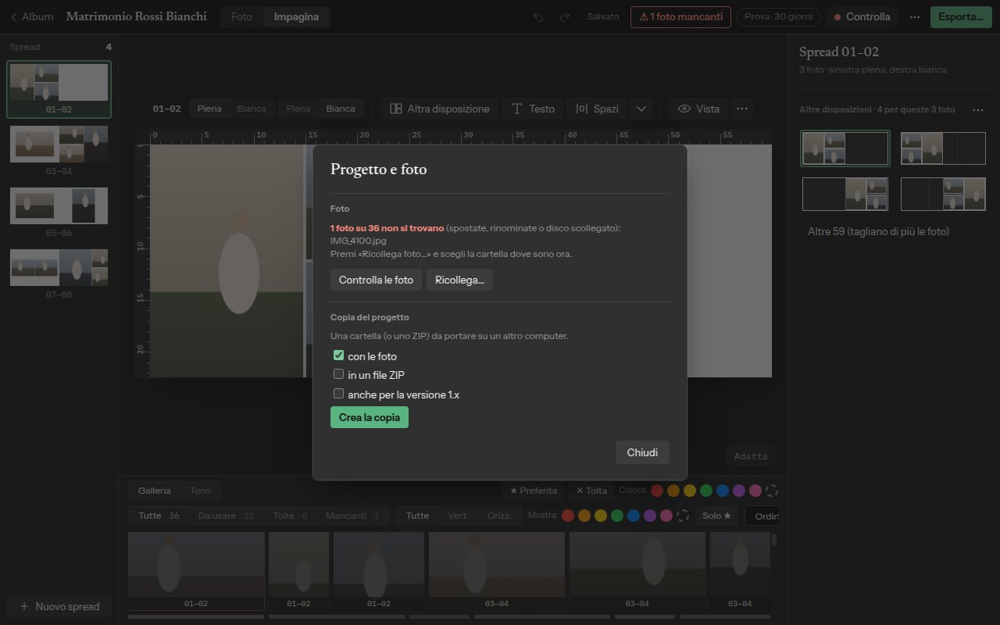

# 10. Progetti ricevuti, copie e foto da ricollegare

## Le foto mancanti

L'album ricorda dove sono le foto. Se sposti o rinomini una foto, o scolleghi il disco dove sta, l'album non la trova
più.

In alto compare il pulsante rosso «⚠ N foto mancanti». Le foto mancanti bloccano l'esportazione.

### Ricollegare le foto

1. Premi «⚠ N foto mancanti». Si apre «Progetto e foto». Lo trovi anche in «⋯» › «Progetto e foto…».
2. Leggi quali foto non si trovano.
3. Premi «Ricollega…».
4. Scegli la cartella dove sono le foto adesso. Va bene anche una cartella che le contiene in sottocartelle.
5. Il programma cerca le foto con lo stesso nome e le ricollega.

Se hai solo ricollegato un disco esterno, premi «Controlla le foto»: il programma le cerca di nuovo dove erano.

Il programma non ricollega una foto con lo stesso nome ma diversa (altra misura o altra data). Le foto rinominate non
le trova: rimetti il nome di prima.

## Mandare un album a un altro computer

1. Nell'album, premi «⋯» › «Progetto e foto…».
2. In «Copia dell'album» scegli:
   - «con le foto»: le foto vanno nella copia. Senza, chi riceve deve avere le foto e ricollegarle;
   - «in un file ZIP»: oltre alla cartella crea un file ZIP, comodo da mandare;
   - «anche per la versione 1.x»: solo se chi riceve usa ancora Impaginatore 1.x.
3. Premi «Crea la copia».
4. Scegli dove metterla. Il programma crea la cartella «nome dell'album - progetto» (e il file ZIP).

Nella copia ci sono:

- l'album con tutte le correzioni, le miniature e i tuoi modelli;
- le foto, se le hai chieste;
- `font_usati.txt`: i caratteri dei testi, da installare sull'altro computer;
- `LEGGIMI.txt`: come aprire la copia.

I PSD non sono nella copia: si rifanno con «Esporta…».

> La versione 1.x non ha le protezioni della 2.0 contro i progetti preparati per fare danni. Con la 1.x apri solo
> progetti di persone di cui ti fidi.

## Aprire un album ricevuto

**Un file ZIP**

1. Nella schermata Album premi «⋯» › «Importa ZIP…».
2. Scegli il file ZIP.
3. L'album compare nell'elenco: «Album importato.» Il programma lo mette nella cartella degli album. Se c'è già un
   album con lo stesso nome, aggiunge un numero: «Matrimonio Rossi 2».

**Una cartella**

1. Nella schermata Album premi «⋯» › «Apri album esistente…».
2. Scegli la cartella dell'album (quella che contiene `progetto.json`).
3. L'album compare nell'elenco: «Album aggiunto all'elenco.» Resta nella sua cartella.

Il programma controlla l'album ricevuto prima di aprirlo e non esegue niente di quello che contiene.

Se l'album è arrivato senza le foto, premi «⚠ N foto mancanti» e ricollegale (sopra).

## Album della versione 1.x

Un album fatto con Impaginatore 1.x si apre con «Apri album esistente…». Il programma lo converte quando lo apri.
