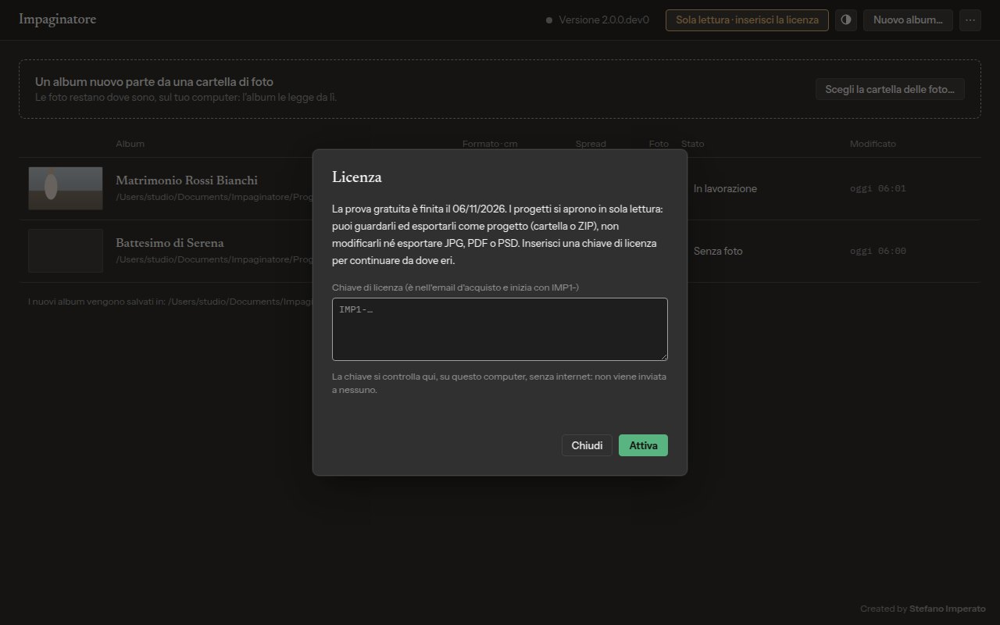
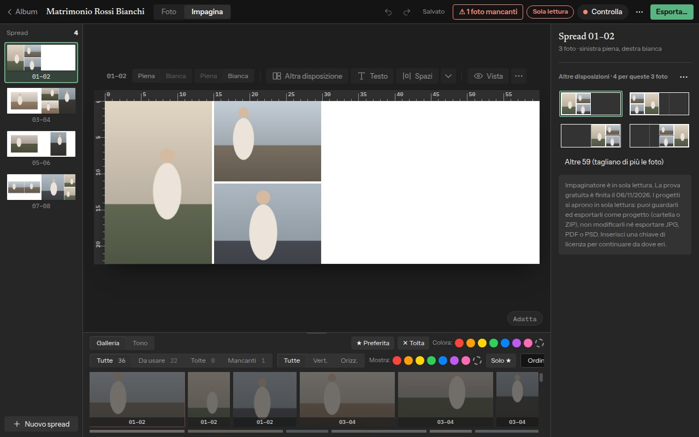

# 11. Prova gratuita e licenza

## La prova gratuita

- Dura 30 giorni dalla prima volta che apri il programma. Non serve registrarsi.
- Hai tutte le funzioni della licenza Pro, tranne i PSD.
- I JPG e i PDF esportati hanno la filigrana.

I giorni che restano li leggi:

- nella schermata Album, sul pulsante «Prova gratuita · N giorni»;
- nell'editor, in alto: «Prova · N giorni»;
- negli ultimi 7 giorni, in fondo alla schermata Album: «Prova: restano N giorni».

## Quando la prova finisce

Il programma passa in **sola lettura**. Il tuo lavoro non si perde.

In sola lettura puoi:

- aprire gli album e guardarli;
- fare la copia del progetto (cartella o ZIP);
- tornare a una versione salvata.

Non puoi:

- modificare gli album;
- esportare JPG, PDF o PSD.

Nella schermata Album il pulsante della licenza diventa «Sola lettura · inserisci la licenza». Nell'editor leggi «Sola
lettura».

Quando inserisci la chiave, riprendi da dove eri.

## Inserire la chiave di licenza

La chiave è nell'email d'acquisto e comincia con `IMP1-`.

1. Apri la schermata Album. Se sei nell'editor, premi «‹ Album».
2. Premi il pulsante della licenza in alto («Prova gratuita · …» o «Sola lettura · inserisci la licenza»).
3. Si apre «Licenza». Incolla la chiave nel riquadro «Chiave di licenza».
4. Premi «Attiva».

Il pulsante diventa «Licenza» con il nome della tua licenza, per esempio «Licenza Pro».

La chiave si controlla sul tuo computer, senza internet. Non viene mandata a nessuno.

Se leggi «Chiave non valida»:

- controlla di averla copiata tutta, dall'inizio `IMP1-` alla fine;
- la chiave vale per le versioni 2.x del programma: una chiave di un'altra versione non va;
- se il problema resta, scrivi all'assistenza con l'email d'acquisto.

Nell'editor, il clic sul segno della licenza in alto spiega lo stato. «Vedi la licenza» ti porta alla schermata Album.

## Cambiare computer

1. Sul computer vecchio, apri «Licenza» e premi «Togli da questo computer».
2. Conferma con «Togli la licenza».
3. Sul computer nuovo inserisci la stessa chiave.

Gli album restano sul computer vecchio. Per portarli usa la copia del progetto (vedi [Progetti ricevuti e
copie](10-progetti-e-foto.md)).

Quanti computer puoi usare con una licenza lo dicono le condizioni d'uso che hai accettato all'acquisto.

## Le licenze

Le funzioni che cambiano da una licenza all'altra:

| Funzione | Essenziale | Pro | Studio | Prova |
|---|---|---|---|---|
| Editor, JPG e PDF | sì | sì | sì | sì, con filigrana |
| PSD a livelli | no | sì | sì | no |
| «Prepara la bozza» | no | sì | sì | sì |
| «Sistema» e «Correggi tutto l'album» per gli spazi | uno spread alla volta | tutto l'album | tutto l'album | tutto l'album |
| «Uniforma il tono» | no | sì | sì | sì |
| Modelli tuoi | fino a 5 | senza limite | senza limite | senza limite |
| Assistente AI (Claude) | no | sì | sì | sì |

La licenza non scade: la compri una volta.
