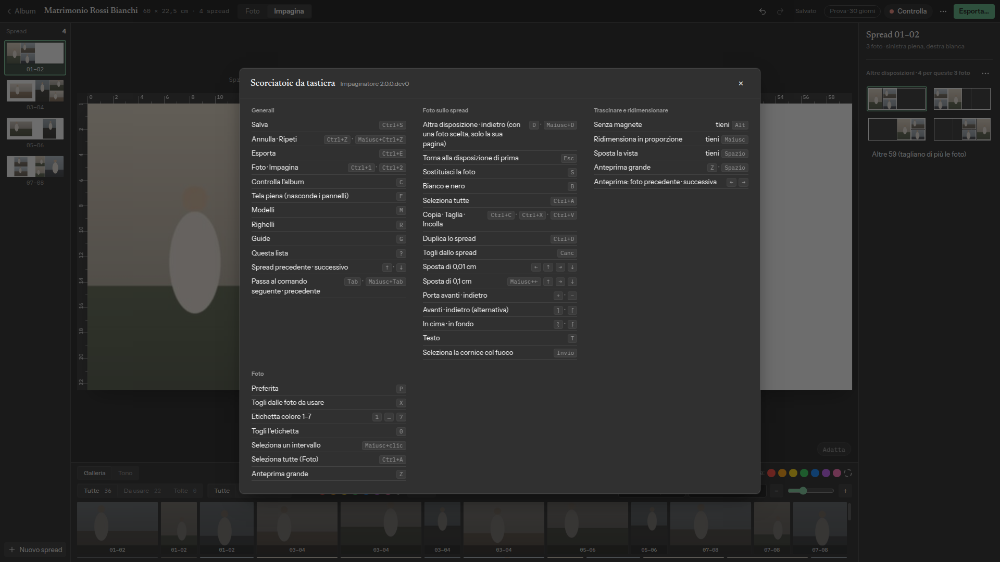

# 12. Scorciatoie da tastiera

Nell'editor premi ? per vedere questa lista. La trovi anche in «⋯» › «Scorciatoie da tastiera».

Sul Mac: ⌘ al posto di Ctrl, ⇧ al posto di Maiusc, ⌥ al posto di Alt. Canc è il tasto ⌫ o ⌦.

## Generali

| Comando | Tasti |
|---|---|
| Salva | Ctrl+S |
| Annulla · Ripeti | Ctrl+Z · Maiusc+Ctrl+Z (anche Ctrl+Y) |
| Esporta | Ctrl+E |
| Foto · Impagina | Ctrl+1 · Ctrl+2 |
| Controlla l'album | C |
| Tela piena (nasconde i pannelli) | F |
| Modelli | M |
| Righelli | R |
| Guide | G |
| Questa lista | ? |
| Spread precedente · successivo | ↑ · ↓ |
| Passa al comando seguente · precedente | Tab · Maiusc+Tab |

## Foto sullo spread

| Comando | Tasti |
|---|---|
| Altra disposizione · indietro | D · Maiusc+D |
| Torna alla disposizione di prima | Esc |
| Sostituisci la foto | S |
| Bianco e nero | B |
| Seleziona tutte | Ctrl+A |
| Copia · Taglia · Incolla | Ctrl+C · Ctrl+X · Ctrl+V |
| Duplica lo spread | Ctrl+D |
| Togli dallo spread | Canc |
| Sposta di 0,01 cm | frecce |
| Sposta di 0,1 cm | Maiusc+frecce |
| Porta avanti · indietro | + · − |
| Avanti · indietro (alternativa) | ] · [ |
| In cima · in fondo | } · { |
| Testo | T |
| Seleziona la cornice col fuoco | Invio |

## Trascinare e ridimensionare

| Comando | Tasti |
|---|---|
| Senza magnete | tieni Alt |
| Ridimensiona in proporzione | tieni Maiusc |
| Sposta la vista | tieni Spazio |
| Anteprima grande | Z · Spazio |
| Anteprima: foto precedente · successiva | ← · → |

## Foto (vista Foto e Galleria)

| Comando | Tasti |
|---|---|
| Preferita | P |
| Togli dalle foto da usare | X |
| Etichetta colore 1–7 | da 1 a 7 |
| Togli l'etichetta | 0 |
| Seleziona un intervallo | Maiusc+clic |
| Seleziona tutte (Foto) | Ctrl+A |
| Anteprima grande | Z |

## Schermata Album

| Comando | Tasti |
|---|---|
| Scegli l'album | ↑ · ↓ |
| Apri l'album | Invio |
