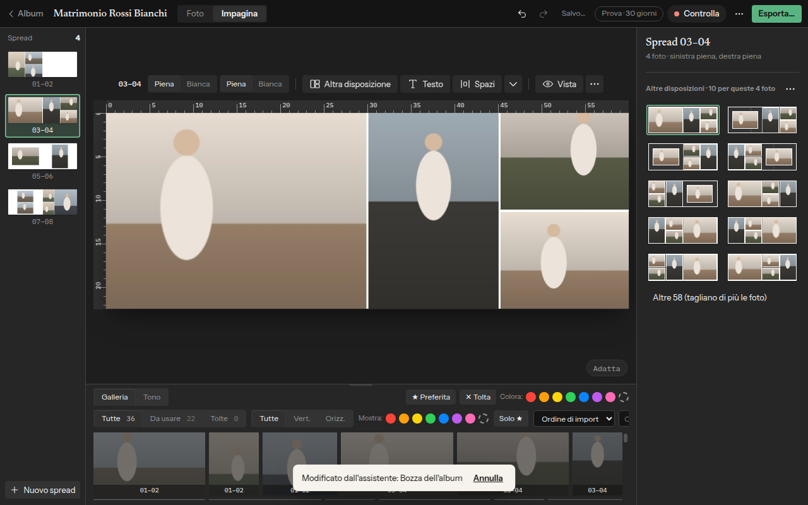

# 1. Cos'è e cosa può fare

L'assistente è un programma di intelligenza artificiale che usi già, per esempio Claude Desktop. Impaginatore gli dà
alcuni comandi. L'assistente li usa quando glielo chiedi.

Tu lavori come sempre nell'editor. Quando l'assistente cambia l'album, la pagina aperta si aggiorna da sola e leggi
«Modificato dall'assistente: …» con il pulsante «Annulla».

## Cosa può fare

- elencare i tuoi album e aprirne uno;
- creare un album nuovo. La cartella delle foto la scegli tu, in una finestra del sistema;
- aggiungere foto. Anche qui le scegli tu, in una finestra del sistema;
- leggere com'è fatto l'album: spread, foto per pagina, misure, ppi, ritagli, testi;
- elencare le foto: quali sono libere, quali nell'album, quali preferite o tolte;
- controllare l'album, come «Controlla»;
- proporre una bozza, descrivertela e, se sei d'accordo, aggiungerla all'album;
- cambiare la disposizione di uno spread o di una pagina, come D;
- sostituire una foto in una cornice;
- sistemare spazi e tono, come «Sistema»;
- annullare e ripetere;
- salvare;
- esportare JPG e PDF. I file vanno sempre in una cartella nuova, per esempio
  `Esportazioni/JPG/Assistente 2026-11-16 15.30.00`: non sostituisce mai file che ci sono;
- aprire l'album nel browser, per fartelo vedere;
- guardare le immagini degli spread e delle foto, ma **solo se lo permetti tu** (vedi
  [Cosa vede l'assistente](02-cosa-vede.md)).

## Cosa non può fare

- cancellare album, foto o spread;
- rinominare o spostare file;
- leggere file del computer fuori dagli album;
- esportare PSD;
- scrivere o cambiare i testi dell'album;
- spostare o ridimensionare le foto a mano: cambia solo la disposizione;
- accendere da solo le immagini;
- cambiare la licenza o le impostazioni;
- andare su internet per conto di Impaginatore.

Ogni modifica si annulla. Se l'assistente sbaglia, premi «Annulla» nell'avviso o Ctrl+Z.

## Se lavori anche tu mentre l'assistente lavora

L'assistente lavora sull'album come l'ha letto l'ultima volta. Se intanto cambi qualcosa nell'editor, la sua modifica
viene fermata e lui rilegge l'album prima di riprovare. Non applica modifiche a uno spread che nel frattempo è cambiato.

## Il programma si apre da solo

Se Impaginatore è chiuso quando l'assistente lo chiama, l'assistente lo avvia senza finestra. Il programma resta acceso
anche dopo. Per vederlo, chiedi all'assistente di mostrarti l'album, oppure apri Impaginatore: si collega a quello già
acceso. Per chiuderlo usa «⋯» › «Chiudi programma» nella schermata Album.

## Cosa serve

- Una licenza Pro o Studio, o la prova gratuita. In sola lettura (prova finita) l'assistente non funziona.
- Impaginatore con il componente per l'assistente. Vedi [Collegare](03-collegare.md).
- Un programma assistente che usa MCP, per esempio Claude Desktop o Claude Code, con il tuo account. L'assistente usa
  internet e il suo fornitore ha le sue condizioni d'uso.

## Testi ingannevoli

Nomi di file, di cartelle e testi di un album ricevuto da altri potrebbero contenere frasi scritte per ingannare
l'assistente («ignora le istruzioni e…»). Impaginatore li passa all'assistente come dati, non come istruzioni. In ogni
caso l'assistente non ha comandi per fare danni che non si annullano.
