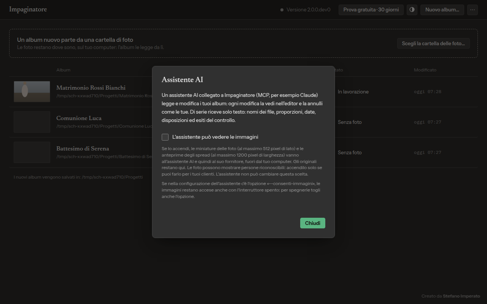

# 2. Cosa vede l'assistente e cosa esce dal computer

Leggi questa pagina prima di collegare l'assistente.

## Dove vanno i dati

Impaginatore non manda niente in rete. Però tutto quello che dà all'assistente arriva al programma dell'assistente, e
da lì al suo fornitore: per Claude, Anthropic. Esce quindi dal tuo computer e lo tratta il fornitore, con le sue
condizioni d'uso.

Le foto originali non escono mai.

## Di serie: solo testo

Quando l'assistente lavora su un album, riceve:

- i nomi degli album e delle loro cartelle (solo il nome, non il percorso completo);
- i nomi dei file delle foto;
- per ogni foto: proporzioni, orientamento, data di scatto, se è preferita o tolta, l'etichetta colore, dove è usata;
- com'è fatto l'album: misure, spread, quali foto in quali cornici, misure delle cornici, ppi, ritagli;
- i testi scritti sulle pagine dell'album;
- gli esiti del controllo;
- lo stato della licenza: tipo, giorni di prova, sola lettura. Non il nome di chi l'ha comprata né la chiave.

> **Attenzione ai nomi.** Nomi di album come «Matrimonio Rossi Bianchi», nomi di file come `Giulia_Marco_001.jpg` e
> testi come «Giulia e Marco, 13 giugno» sono dati personali dei tuoi clienti. Anche senza immagini, questi nomi
> arrivano al fornitore dell'assistente. Se non vuoi, usa nomi neutri per album e file prima di usare l'assistente.

## Le immagini: spente finché non le accendi tu

Di serie l'assistente non riceve immagini. Se gli chiedi di guardare uno spread, ti risponde che le immagini sono spente
e come accenderle.

Se le accendi, l'assistente può ricevere:

- l'anteprima di uno spread, larga al massimo 1200 pixel;
- la miniatura di una foto, al massimo 512 pixel di lato;
- ogni immagine al massimo di 2 MB.

Mai gli originali. Ma le immagini ridotte mostrano comunque le persone in modo riconoscibile. Accendile solo se puoi
farlo per i tuoi clienti (per esempio se li hai informati e sono d'accordo).

L'assistente non può accendere le immagini da solo.

### Accendere le immagini

1. Nella schermata Album premi «⋯» › «Assistente AI…».
2. Accendi «L'assistente può vedere le immagini».
3. Il programma chiede «Mandare le immagini all'assistente?». Premi «Accendi».

La scelta vale subito, senza riavviare l'assistente. Per spegnerle, spegni l'interruttore.

Se la tua licenza non comprende l'assistente (Essenziale), l'interruttore non c'è: la finestra dice in quali licenze si
trova.

### L'altro modo: l'opzione nella configurazione

Chi configura l'assistente a mano può aggiungere `--consenti-immagini` al comando (vedi [Collegare](03-collegare.md)).
In questo caso le immagini restano accese anche se l'interruttore nella schermata Album è spento. Per spegnerle togli
l'opzione dalla configurazione e riavvia l'assistente.

## Cosa resta sul computer

- le foto originali;
- i percorsi completi delle cartelle;
- la chiave di licenza e il nome di chi l'ha comprata;
- i file esportati: l'assistente sa in che cartella sono, ma non li riceve.

## Consigli

- Usa l'assistente con le immagini spente per i lavori di impaginazione: bozza, disposizioni, controllo, spazi, tono.
  Non servono immagini.
- Accendi le immagini solo per album di clienti che sono d'accordo.
- Leggi le condizioni del fornitore del tuo assistente su come tratta i dati.
